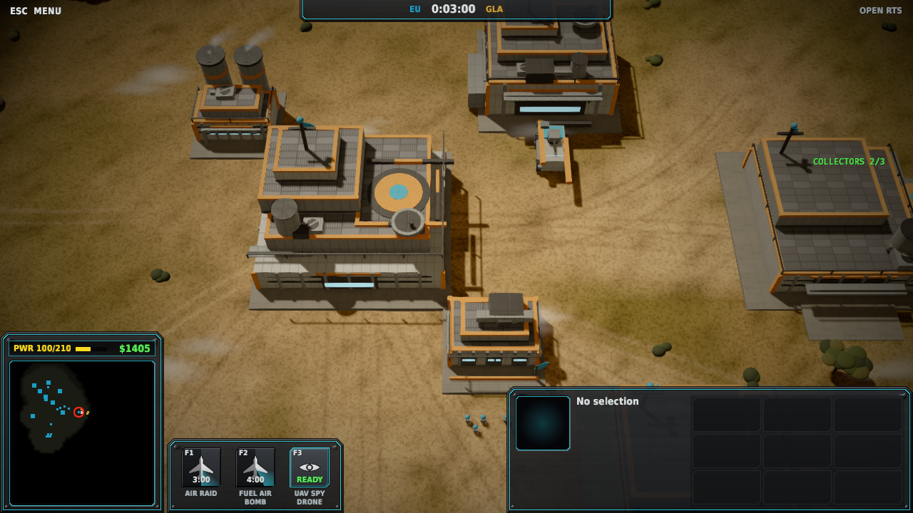
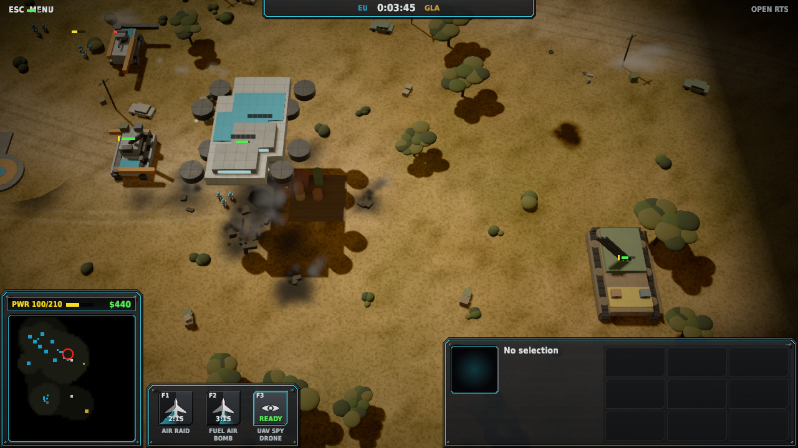
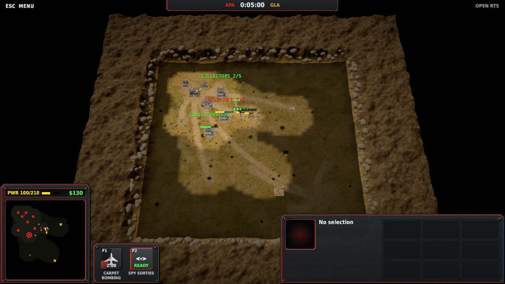
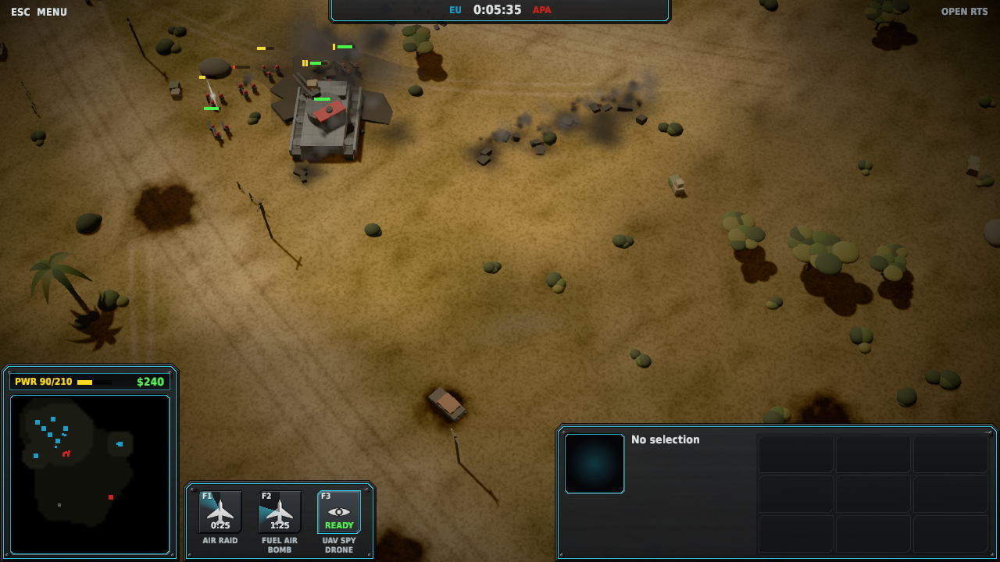
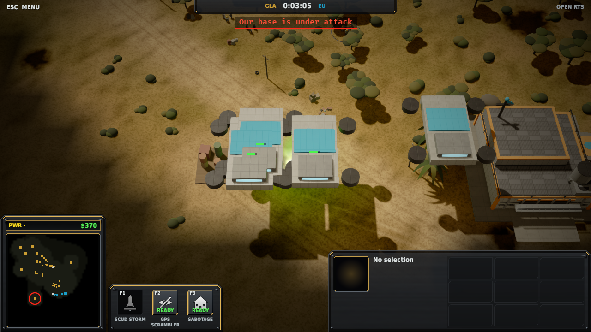
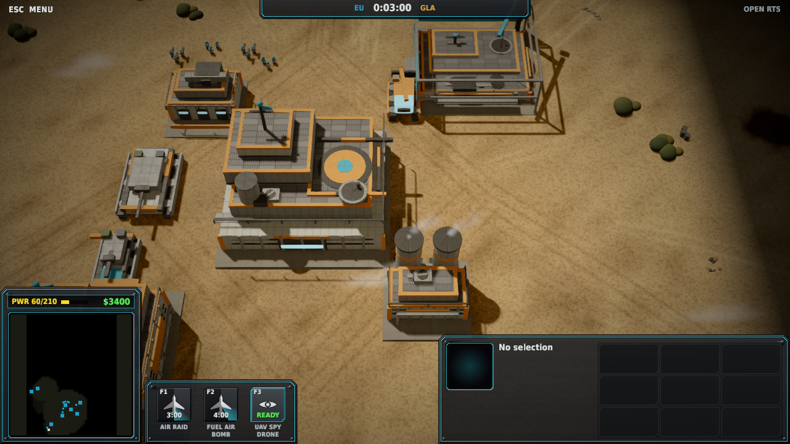
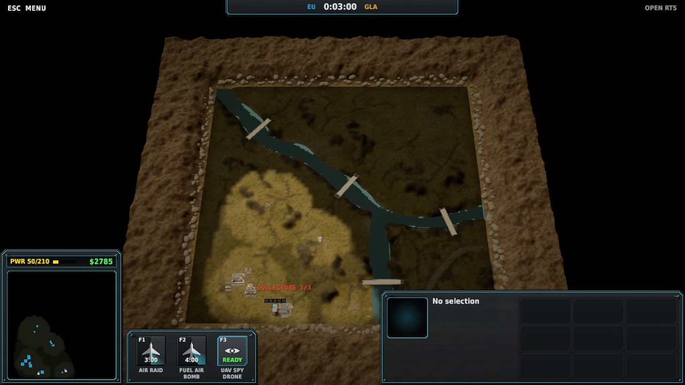

# generals2

Open-source recreation of the cancelled *Command & Conquer: Generals 2*, as a new engine written in Rust. Not affiliated with or endorsed by EA. All trademarks are the property of their respective owners.

**Website:** <https://boredland.github.io/generals2/> · **Download** (Linux, Windows, macOS): [latest release](https://github.com/boredland/generals2/releases/latest)

The engine needs no game files. EA's GPL release of *Generals/Zero Hour* in `vendor/` is reference for the engine: no code from it is ported or copied into `crates/`. The one runtime use of `vendor/` is map data: the original Generals and Zero Hour **maps** can be played, read at runtime from EA's GPL map sources (`vendor/ea/CnC_Modding_Support`, a git submodule) and never copied into this repository. All art is original and procedural: meshes built from primitives, generated terrain and textures, our own HUD design. The archived 2013 footage sets the target mood (warm hard light, steep camera, savanna ground); `docs/STYLE.md` describes it as requirements, not as elements to copy.

## Status: milestone 14, skirmish in teams against three AI levels, missions, heroes, co-op and internet play on Linux, Windows and macOS, Generals' menus with real dropdowns, the alpha's build times, prices and opening, support powers by command center and rank, the alpha's systems, generals and abilities

What works:

- **Deterministic simulation** (`crates/g2-sim`): 30 ticks/s like SAGE, 48.16 fixed point, PCG32, a generational entity arena, a per-tick state hash. No floats in state, no dependencies, no IO. About 80,000–88,000 ticks/s single-threaded (about 2,800× real time) for a 10-minute 2-player Easy-AI match on Crater Ridge with armies, artillery and fog, and 45,000–48,000 for Normal AIs, whose matches are larger (121 entities at the end against 71). Unit updates take about half of a tick and fog a fifth. Local avoidance costs about 5% (measured against the build before it on the same machine: 60,000 against 64,000 ticks/s Easy, 61,000 against 64,000 Normal; this machine's absolute figures run below the ones above). Straight-line checks skip sampling when a summed-area table shows the box between the two ends is clear, fog marks each row's visible run at once, and unit separation works on copied positions.
- **Generals 2 economy**, from the archived sources:
  - Credits from supply piles, carried by collectors to a supply center: after each load, the nearest one of yours with room under its collector cap (the one a collector was trained at always has room for it), so a new supply center by a far pile takes over its runs.
  - Collector cap per supply center: **EU 3, APA 5, GLA 8**.
  - Oil derricks, which can only sit on oil wells and pay credits until the well is dry. The archived sources say oil was first meant to be a second resource, but the August 2013 patch made derricks "provide additional funds"; this follows the patch, so credits are the only currency.
  - Local power: plants power consumers within a radius. Unpowered production runs at half speed. The GLA has no grid.
  - Constructors place foundations that must be worked on, production queues with full refunds on cancel, and surrender/defeat.
  - **A skirmish start** is the alpha's: the command center and a constructor, plus the faction's supply center already standing beside it, toward the nearest pile, with two collectors at work (`World::spawn_start_economy`, free). The archived footage shows "Harvesters: 2/5" four seconds into an APA match and 2/8 for the GLA; with the alpha's 70 s, $1,800-1,990 supply center (see Build times) no opening could afford to build one first. A mission places only its own forces.
- **Three factions** (`crates/g2-rules`): EU, APA and GLA. Command center, constructor, supply center, collector, power plant, oil derrick, barracks and war factory each. Each barracks trains a rifle squad and an anti-armour rocket squad; each war factory a tank, an artillery piece and a fast light vehicle (EU: Recon Squad, Rocket Squad; Aegis, Howitzer, APC. APA: Red Guard, Tank Hunter; Warlord, Thunderfist, Gatling Tank. GLA: Rabble Squad, RPG Squad; Scorpion, Toxin Artillery, Technical). Per credit, rocket squads do about twice a rifle squad's damage to tanks and two thirds of it to infantry; the light vehicles outrun everything else their factory builds. Sourced numbers are tagged `# src:` (the EU Rocket Squad's hp, cost and build time, the APC's and the Gatling Tank's cards), everything else is a placeholder (every new unit's weapon but the APC's, and all of the GLA RPG Squad, which has no archived card). Models: rocket squads shoulder a fat launcher tube; the light vehicles run on four wheels.
- **Combat**: four armour classes from the archived unit cards (Infantry, Light, Heavy, Structure). A weapon deals its base damage plus a per-class bonus, the way the cards state it ("40, bonus 30 vs. Light"), every cooldown, to one target within range. Direct fire hits at once. A squad is one entity carrying the squad's card values. Sourced: the Red Guard's rifles (13, +2 vs. infantry, 0.9 s, range 25) and the Warlord's guns (40, +30 vs. Light, 1.5 s, range 35), plus hit points, costs and build times where the cards give them; everything else borrows those two weapons or is a placeholder. **Infantry hits buildings for half** (`structure_percent` on a weapon): as Zero Hour's structure armour takes small arms and infantry missiles at 50% and tank guns, flame and explosives in full, every infantry rifle, machine gun and rocket here does half its damage to buildings and bridges; flamethrowers, the Saboteurs' charges and shells keep the full amount. The alpha's buildings carry an armour rating, but how one cuts damage isn't archived. Measured before, $1,200 of rifle squads razed an 800 hp barracks in 6 s, about three times Zero Hour's damage per credit (its Rangers would need 18 s), while a tank took 28 s, as Zero Hour's do; now the squads take 13-15 s and anti-armour squads 14-23 s. Across all 86 skirmish maps, Normal against Easy went from 1,455 to 32 (61 undecided) to 1,466 to 26 (56), the median match from 587 s to 608 s (longer on 63 maps); Normal against the Onslaught from 343 to 429 to 374 to 397, holding most matches on 47 maps instead of 41, as its base now outlasts the waves' infantry longer. Orders: attack a unit or building; attack-move (fight anything met on the way); idle armed units guard their spot, engage what comes within range plus 15, chase it on a leash of the same distance, then walk back. All shots of a tick land together after every unit has moved, so the result never depends on entity order and two tanks can kill each other on the same tick. A player is defeated with their last base building, as in a Zero Hour skirmish (`VICTORY_NOBUILDINGS`, objects marked `MP_COUNT_FOR_VICTORY`; `Def::counts_for_victory`): base defences, tunnels and oil derricks don't count, nor do units, constructors included, and whatever is left goes with the base. Before, a constructor or any building kept a player in, so a dozer driven away or a derrick on a far well could keep a lost match going for minutes while the enemy searched the map for it.
- **Build times and prices**: units train in the 2013 alpha's own blueprint times (`BuildTime`), where they differ from the older archived cards the base roster first used: the Aegis and Warlord 18 s (cards 24.44 s), Scorpion 14 s, Gatling Tank 16 s (23.3), Thunderfist and Toxin Artillery 24 s (21.51, 30.11), EU APC 12 s (14.66), Rocket Squad 12 s (16.29), RPG Squad 13 s, rifle squads 7-8 s (6.27), constructors 10-11 s, the APA harvester 17 s, the Technical 12 s and the Valkyrie 24 s (32.58); unit prices stay the cards'. Every faction building takes the alpha blueprint's time and price too (`Cost`): supply center 70 s and $1,990 (EU), $1,890 (APA), $1,800 (GLA stash), where they were 20 s and $800 (GLA 18 s, $600); power plant $250 in 10 s (EU) or 15 s (APA), from $600 and 15 s; oil derrick $600 in 22 s, from $500 (GLA $400) and 15 s; barracks $500 in 18 s (EU), $400 in 18 s (APA) and 22 s (GLA), from $500 and 15 s; command centers and war factories already matched. Hit points stay the cards' or placeholders (the alpha's are mostly lower: a barracks 500, ours 800). Zero Hour builds about twice as fast (its Crusader 10 s, Ranger 5 s); the alpha's pace is kept. Measured on all 86 skirmish maps, with infantry already at half damage to buildings: the unit times moved Normal against Easy from 1,466 to 26 (56 undecided) to 1,467 to 32 (49), against the Onslaught from 374 to 397 to 395 to 376 (most matches held on 54 maps, from 47). The building values alone then took the Onslaught to 189 to 583 (10 maps) and lost Iron Dragon and Burnt Orchards on Normal: each building measured alone, only the supply center mattered (332 to 440; the power plant, derrick and barracks each moved it by under 5), as an AI's second center now comes at 2:40 instead of 0:23. With the alpha's start economy (above) 312 to 457 (34 maps), and with the Onslaught's waves growing by nine units every six instead of eleven, 409 to 362 (55 maps); Normal against Easy 1,446 to 53 (49 undecided). An AI that has spent every pile and has no derrick sends whatever army it has instead of waiting for a full wave (Easy did already); a Hard 2v2 on Tournament Tundra otherwise stood still from 20 minutes on once units trained at the alpha's pace.
- **Footprints** from the alpha's blueprints: a unit's radius is its `EntityRadius` (2 for infantry and light vehicles, 3.5 for tanks, 4 for aircraft and the EU harvester, an airborne collector) and a building's is half its build grid (`RtsBuildGridAABB`, e.g. 12 for a command center or war factory, 6 for a barracks). Collision, spacing, placement, pathing, ranges and splash all measure from these edges. The client draws every imported alpha model at the alpha's own scale, so units and buildings keep the alpha's proportions; the procedural vehicles are drawn 1.5 times longer, the alpha's median length for its vehicles against their footprints. The bigger buildings cost the Normal AI (Normal against Easy on all 86 maps 1,213 to 303 with 32 undecided, from 1,256 to 283; against the Onslaught 578 to 189, from 625 to 143), so it was re-tuned against those measures: its base zone (where intruders trigger its defence) reaches 40 from the edge of any of its buildings, not 50 from its centre; its home supply pile counts as spent once it lies over 88 from the command center's edge, not 90 from its centre; it expands by 5:00 at the latest; and its waves gather 7 strong (Easy keeps 5). Together: 1,254 to 272 against Easy (22 undecided) and 575 to 184 against the Onslaught. Each measured alone: the base zone 1,220 to 304; waves of 7 then 1,223 to 301 and 556 to 200 against the Onslaught (without them, with the rest, 1,252 to 278 and 564 to 203); the home pile from the command center's edge 1,256 to 267, but 532 to 224 against the Onslaught, because Normal then expanded too late on maps where the pile lies just inside its reach (Red Rock 9 to 0 became 3 to 5), which the 5:00 limit fixed (by 3:00, 1,152 to 383 against Easy; by 4:00 or 5:00 about the same; by 7:00, 543 to 216 against the Onslaught). A smaller EU harvester (radius 2, not the alpha's 4) changed nothing (1,217 to 305).
- **Artillery**: shell weapons lob a shell at the spot the target stood on when it fired. The shell lands after its flight time (distance over shell speed) and damages every enemy whose edge is within its blast radius, with each victim's armour bonus; a unit that moved away in the meantime is missed. Splash never hurts the shooter's side. Artillery has a minimum range and won't fire inside it. Shells in flight are part of the state hash.
  - **APA Thunderfist** (sourced: hp 600, Heavy, $980; build time the alpha's 24 s; cannon 40 +30 vs. light, 1.65 s, range 30; deployed howitzer 100 +30 vs. light, 4 s, range 65): it drives and fights with its cannon and must deploy (stop and set up, 3 s, a placeholder) to fire the howitzer. It deploys on its own when an attack target, or an enemy met on an attack-move or while guarding, is beyond the cannon but within the howitzer's reach. Deployed it can't move: a move order packs it up first, and on an attack-move it packs up once nothing is left in the howitzer's reach. The card's +100 against garrisoned buildings applies to a building with units inside when the shell lands. It sees as far as the howitzer reaches.
  - **GLA Toxin Artillery** (sourced: hp 950, $1000; build time the alpha's 24 s) and **EU Howitzer** (placeholder throughout; no EU artillery card is archived): both fire on the move. The toxin shell's damage over time is not modelled.
  - Blast radius, shell speed and minimum range are placeholders, shaped like Zero Hour's artillery.
- **Upgrades** (`Upgrade` and `Effect` in `crates/g2-sim/src/defs.rs`, the table in `crates/g2-rules/data/upgrades.toml`): one-time research in a building's production queue, paid up front and refunded in full by a cancel, as in Zero Hour. A finished upgrade applies to every unit or building of the defs it lists, fielded and future: more damage (against all armour or one class, or on artillery shells only), faster fire, less damage taken, more hit points (fielded units gain them on top of their current ones, as Zero Hour's `ADD_CURRENT_HEALTH_TOO`) or repair after a quiet spell. Bonuses of a kind add up, as Zero Hour stacks them. Nine upgrades for the units we have, at three tech buildings (EU Tech Lab and Advanced Tech Lab, GLA Salvage Bay) and the barracks and war factories. Where each is researched, its price and its time come from the alpha's production data; which units it touches from the units' upgrade lists; what it does from the archived cards; and how much from Zero Hour 1.04's INI data for the matching upgrade (a damage upgrade is +25%, an armour upgrade 75% damage taken, Scrap Repair is Junk Repair's 2 hp a second). Population Control adds a man's share of hit points and fire to a one-entity squad. Hightech Alloys, Improved Ballistics, Senior Warfighter, High Explosives, Hollow Point Ammo (EU); Population Control, Firestorm Shells (APA); Shortened Fuses, Scrap Repair (GLA). The build grid lists a building's upgrades after its units until researched; the Normal AI researches one upgrade at a time, whatever its buildings offer, only with 2,000 credits to spare beyond the price, and builds a tech building once its extra factories stand and credits still pile up. Against Easy (every faction pairing from both starts on three maps) it now wins 41 of 54, researching one or two upgrades a match; a first version that built tech early and researched at its factories won only 35. Replays record research (format v7; v1-v6 still load).
- **Veterancy** (`Veterancy` in `crates/g2-sim/src/defs.rs`): a unit gains a point of experience for each enemy unit it destroys (buildings give none: the alpha's `ExperienceGrantedOnDeath`). Ranks come at 3, 6 and 10 points, the alpha's `RtsVeterancyComponentData`, with its gains: rank 1 adds hit points (current and maximum: +90 for the Aegis, +21 for a recon squad, each unit its own), rank 2 regenerates 5 hit points a second while the unit has no order, rank 3 fires faster (each unit's own cut, as a share of its alpha weapon's interval: Thunderfist 80%, most 90-95%). A rank keeps the lower ranks' gains. Ranked units show gold marks beside their health bar and their rank in the selection panel; a promotion has its own chime (the alpha's `ui_upgrade_unlocked` with an import). The AI counts rank and upgrades in its army-strength estimate. Onslaught waves come ranked too, from the fourth wave on, so a defender who has earned ranks still faces a threat. Constructors and collectors have no weapon here, so they never gain a rank.
- **Aircraft** (`flies` on `Class::Unit`, `Targets` on `Weapon`): one helicopter per faction, from the alpha's data: the EU **Valkyrie** (heavy rocket helo: rockets 120 every 6 s at 60, ground only; hp 500, $1250, 24 s) and APA **Mantis** (light gun helo: machine gun 42, +28 vs. Heavy, every 1.125 s at 35, ground only; hp 300, $950, 24 s) from each faction's **Airfield** (hp 750, $1200, 34 s), and the GLA **Toxin Chopper** (toxin missiles 26, +12 vs. infantry, at 30, ground and air; hp 220, $750, 24 s), which the GLA, with no airfield in the alpha, builds at its war factory as its wiki card says. Speeds and ranks are the alpha's too. Aircraft fly straight over buildings, cliffs and water (a move order sends them to the exact spot) and push apart only from each other, never from ground units. Every weapon says what it can hit, as the alpha's `TargetType` does: anti-air units are the EU Rocket Squad (reaching 40 against aircraft), the APA Gatling Tank (50), the GLA RPG Squad and the Toxin Chopper; rifles, tanks and helicopters with ground-only weapons can't be ordered onto aircraft and don't engage them, and shells burst on the ground only. Armour: Light (the alpha gives none). The client draws them at the alpha's flight height (`AirCeiling` 16.5) with a spinning rotor, or with the alpha's own models. The alpha's jets (EU bomber, APA fighter and bomber) are not airfield units: though the airfields' production lists name them, the alpha has no build button for any of them, and the archived wiki says they can't be built and deliver support powers instead (Air Raid, Fuel Air Bomb, Carpet Bombing, Spy Sortie), each with its own sortie blueprint in the alpha. They come with those powers.
- **Garrisons** (`Garrison` in `crates/g2-sim/src/defs.rs`, after the alpha's `RtsGarrisonComponentData`): armed infantry (a squad takes one place) get into a building or vehicle with room for them: one of their own, or an empty civilian building, which is theirs while they are inside and neutral again once they leave (or their player is defeated). From a civilian building they fire out from its edge, with the alpha's 8-unit range bonus; inside they can't be targeted or hit by splash, and they die with the building. Three civilian buildings from the alpha's African set, by their display name: Shanty (hp 600, room for 2), Town House (800, 3) and Urban Block (1200, 4). The EU APC carries two squads who can't fire from inside (the alpha's capacity and rule); they ride along and get out where it stops. The GLA Battle Bus carries four the same way and becomes the **Battle Bunker** where it stands, on `T` or when destroyed, with its squads still inside (the alpha's `GLA_InstantBunker` and passive `GLA_BattleBusBunker`): from the bunker (hp 525, `gu_battlebus_bunker`) they fire out with an 8-unit range bonus. It is instant and one-way, and it is no base: it doesn't keep a player in the game. Both commands are in replays and lockstep (format v12; v1-v11 still load). Right-click a building or vehicle with room to send selected infantry in; `E` empties the selected ones. Units inside aren't drawn; pips over the container, in its holder's team colour, show how full it is, and the selection panel shows `garrison n/capacity`. The Normal AI sends idle infantry at home into an empty civilian building near its base. Held civilian buildings are no base: they don't keep a player in the match and the AI doesn't defend or target them as one. The generals' Battle Bus (GLA, four squads) and Assault APC (EU) carry squads the same way. Not modelled: the alpha's bunkers and guard towers (no player-buildable source).
- **Stealth and detection** (`stealth` and `detection` on `Def`, `World::sees`): a stealth unit is hidden from enemies even in plain view: they can't see, target or order an attack on it, and their guards ignore it. A detector in range reveals it (the alpha's `StealthDetectionRange`), and so does firing, for the alpha's 2.5 s (`StealthDisableOnFire`); an attack order on a unit that slips back into stealth is dropped. The GLA RPG Squad is stealthed, as the alpha's passive `GLA_RocketSoldier_Stealth` makes it from the start. The detectors are base defences, one per faction from the alpha's blueprints: the **EU Gun Turret** (autocannon 26, +8 vs. infantry, every 0.8 s, range 57; detects within 50), **APA Flame Turret** (flamethrower 44, +20 vs. infantry and +60 vs. garrisoned buildings, every 2 s, range 45; detects within 40) and **GLA Rocket Site** (RPG 40, +28 vs. heavy, every 2.3 s, range 47, and 57 against aircraft; detects within 45). They fire on their own from where they stand, while powered, with range counted from their edge; EU and APA turrets draw 20 power. The Normal AI builds one, once a stealth unit has hit it as soon as its factories stand (holding the army back until it is placed), else after its tech buildings; it counts no building as army strength. Own stealthed units show a dark ring and `stealthed` in the selection panel. The generals' Sniper Team (EU), Saboteurs and Shadow Tank (APA) are stealthed too; the alpha's camera turrets aren't built.
- **Generals as data**: a player may pick a general of their faction; its modifiers change the cost and build time of specific units and buildings (integer percent, deterministic, refunded at the price paid). Each general also has one **active power** with a cooldown, aimed at explored ground. Our first three are **Bulldog** (EU: an artillery barrage, seven shells on and around the point, after the archived EU general Salvo's artillery strike), **Taskmaster** (APA: the alpha's global **Supply Drop**, see below) and **Junkyard** (GLA: an ambush of RPG squads); their effects are placeholders, mod-style sub-generals. The alpha's own generals follow, named after the wiki's generals whose units match the alpha's internal `GeneralUnits` lists (`staticdata/generals/*`): **Daedalus**, **Mercury Red**, **Cutting Edge** and **Cleaver** (EU), **Inferno**, **Red Arrow**, **1000 Suns** and **Blackjack** (APA), **Thrax**, **Wild Dog** and **Kitbash** (GLA). Their powers are the alpha's `GeneralPowers` (Air Raid, Bulwark, Skylance, Plasma Bomb, Inferno Artillery, Thunderclap, Neutron Bomb, Misdirection, Toxin Bomb, Mass RPG Strike, Stealth Field) with its recharge, radius, delay and damage where the alpha has them. The **Neutron Bomb** is a bomb and then a radiation cloud (12 damage a second to enemy ground units and buildings within 20, for the 8 s, then 15 s, that its alpha emitter lives), the Plasma Bomb lands the alpha's 2.5 s after the order, and the Toxin Bomb 0.5 s after (lvl01) or at once. Three powers are **timed area effects** (`PowerKind::Field`, landing after the alpha's delay and putting a timed status on what stands in the area, see Statuses below): Mercury Red's **Bulwark** (own units within 25 take 75%, 70% and 65% damage for the area's sourced 10 s, recharge 180 s; the percentages are placeholders: the alpha's effect asset holds none), Red Arrow's **Thunderclap** (5 s after the order, one shockwave of the alpha's 100 damage over its radius 20, stunning enemy units for 3, 4 and 5 s: the stun is the wiki's "disables unit movement", its seconds placeholders) and Taskmaster's **Supply Drop** (2 s after the order, own units within 30, then 40, gain a veterancy rank, deal the alpha's 115%, 115% and 125% damage for 30 s, and regain 400, 400 and 500 hit points: the alpha heals 15-35 a second for 5 s while idle, so the amount and the rank are placeholders).
  - **Units**: a general's factories train its own units, in place of the ones the alpha says they replace (Junkyard's Shrapnel Tank for the Scorpion, Thrax's Toxin Tank and Mobile Chemist), or in addition (the Battle Bus, Black Market Artillery, Longbow, Railgun Tank, Sunstorm, Shadow Tank, Napalm Mortar Squad...); a general's constructor places its own defences (Cutting Edge's and Cleaver's Railgun Turret for the Gun Turret). 22 units in all, hit points, cost, build time, weapon, range and fire rate from the alpha's `Rts*ComponentData`, veterancy from its `RtsVeterancyComponentData`. A unit has one weapon here, so the alpha's second weapons (the Black Market Artillery's anti-air rockets) are left out. Every faction-wide perk (Protector, Factory Overtime, Leadership, Scavenger) covers the general's units too.
  - **Power levels**: a power has three levels, as in the alpha's `_lvl01`-`_lvl03` assets; the second opens at general rank 3, the third at rank 5. The player's rank with the general is part of their setup in replays and lockstep (format v11, v1-v10 still load at rank 1). Normal, Hard and Onslaught AIs play at rank 3, Easy at rank 1.
  - The Normal and Hard AIs use their general's power (an area power that hits the enemy, Thunderclap, on the visible enemy units with at least two of its faction's strongest units' worth of fighting strength within its radius; one for its own side, Bulwark or Supply Drop, over three or more of its combat units with an armed enemy within 40; a cloak (Stealth Field) over its largest group of combat units out in the field, and Misdirection's holograms over such a group with an armed enemy within 60); Easy fires its general's power only if it hits (a barrage or a strike), at the visible spot with the most enemies within the blast, at least three, and never uses an ambush, a cloak or an area power. Easy and Normal use no power before their first attack (6:00 and 4:00). The general and its power timer are part of the state hash, and the `Power` command is in replays; replay files naming an unknown or wrong-faction general, or a rank outside 1-5, are refused with an error.
- **Tunnel network** (`BuildingRole::Tunnel`, the GLA Worker's **GLA Tunnel Network**: hp 500, $600, 30 s from the alpha's `gs_tunnelnetwork_entrance`): every tunnel of one player shares one garrison, so infantry that go in at one come out at any other (E at the tunnel they should leave by). The network holds 10 squads and heals whoever is inside to full in 5 s; the alpha's data has neither number, so both are Zero Hour's (`MaxTunnelCapacity`, `TimeForFullHeal`). A tunnel that falls passes its occupants on to another standing tunnel; they die with the last one. Infantry only (the alpha's vehicle upgrade is left out), and every tunnel is a full entrance (the alpha trains cheaper exits at an entrance). The AI doesn't build tunnels yet.
- **Misdirection** (`PowerKind::Decoys`, Blackjack's power, radius 15/15/20 from the alpha): every armed ground unit of the player's at the point gets a holographic copy beside it that takes orders and fires like it, deals no damage, and vanishes after 20/25/30 s (placeholders) or at the first hit, giving no experience. To the enemy a copy is a unit of the real def; its owner sees a glowing double ring under it and HOLOGRAM with its time left in the selection panel. The Normal and Hard AIs cast it over their largest field group in a fight and send idle copies at the nearest enemy.
- **Statuses** (`Status` in `crates/g2-sim/src/entity.rs`): an entity can carry timed changes, each with an end tick: damage taken, damage dealt, speed, sight (in percent of normal) and stunned (neither moving nor firing; its gun still reloads and its orders wait). One of a kind and direction at a time: a stronger one replaces it, an equal one refreshes it to the later end, a weaker one is ignored; a buff and a debuff of one kind both count. A status is gone as its end tick begins. They are in the state hash only while one is on, so matches without them hash as before. Powers and abilities put them on; each shows on the unit (a blue shimmer for a shield, sparks for a stun, exhaust fire for a speed boost, dark sputter for a slow, embers or soot for more or less damage, a ring for a sight boost) and in its selection line with the seconds left.
- **Unit abilities** (`Ability` and `Blast` in `crates/g2-sim/src/defs.rs`, the `Ability` command with its slot and aim, replay format v18; `crates/g2-sim/src/ability.rs`): a unit has up to three abilities, each recharging on its own, on `R`, `F` and `C`; one used in place goes at once, one aimed at the ground or an enemy is armed and the next left click aims it, and the unit walks within reach first. The GLA Scorpion and Shrapnel Tank have **Nitro** (speed 150% for 5 s, every 30 s), the Longbow **Radar Pulse** (sight 150% for 10 s, every 30 s): the alpha names both (`gla_mediumcannonnitro`, `eu_radarpulse`) with no numbers, so those are placeholders. Self-destructs share one parting-blast primitive, set off the tick after the unit dies, however it dies, against enemies only: the Bomb Truck's charge (185, +85 against heavy armour, radius 13, the alpha's `Suicidal` weapon: driving into an attack or **Detonate** blows it, and so does being destroyed), the Dragon Tank's **Ignition** (the alpha's "Detonation" parting shot: 50 within 20, then fire burning 10 a second for 5 s; the Inferno general's damage perk that shared the name is now **Wildfire**) and the Sunstorm's passive **Nuclear Fission** (its "CoreBreach": 50 within 20, radiation at 10 a second for 7 s). The Sunstorm's **Uranium Pile Eject** (`R`, then an enemy) throws a rod up to 55 that bursts for 100 (+75 heavy) within 10 and leaves radiation (10 a second for 10 s, every 30 s; the alpha's range and blast, the cloud and recharge placeholders). The Normal and Hard AIs use Nitro to close on a target beyond a gun's reach or to get away when falling back, Radar Pulse in a fight, a Bomb Truck beside an enemy building or two enemy units, and a Dragon Tank's Ignition once it is down to a quarter of its hit points with an enemy in reach; Easy uses none.
- **Heroes** (`crates/g2-sim/src/ability.rs`, defs in `crates/g2-rules/data/units.toml` and `abilities.toml`): one per faction, trained at its command center, one at a time per player (a second is refused while one stands or is queued). Hit points, price, build time, speed and guns are the alpha's commando squads': the **EU Commando** ($1950, 24 s, 510 hp, a machine gun of 50 to 30 every 1.5 s that splashes 8 around its target), the **APA Commando** ($1800, 24 s, 610 hp, a rifle of 100, +42 against infantry, to 50 every 4.2 s) and the **GLA Agent** ($1800, 24 s, 510 hp, unarmed). Each recharges an ability for its alpha mana cost in seconds (100 mana regaining 1 a second). EU: **Grenade Volley** (`R`, a point within 50: 50 grenades of 100 within 5 over the point and two rings around it, every 50 s), **Unstoppable** (`F`: half the damage taken and a quarter more dealt for 10 s, every 50 s) and **Rally** (`C`: own infantry within 30 deal a quarter more for 15 s, every 28 s). APA: **Anti-Materiel Shot** (`R`, an enemy within 50: one shot of 1000, every 60 s), **EMP Grenade** (`F`, a point within 40: enemies within 15 neither move nor fire for 5 s, every 40 s) and **Incendiary Grenade** (`C`, a point within 50: 40 within 5, then 20 a second for 5 s, every 60 s). GLA: **Vanish** (`R`: hidden and half again as fast for 10 s, every 23 s), **Flak Trap** (`F`, a point within 50: a hidden charge that waits until an enemy aircraft comes within 15, then hits every one that near for 125 and is spent, every 30 s; only its owner sees it) and **Last Stand** (`C`, a point within 75: every other armed squad of the agent's within 30 blows up for 100 within 8 where it stands, every 30 s). Unstoppable's, Rally's and Vanish's amounts, the incendiary burn's 5 s and Last Stand's blast are placeholders (the alpha's abilities carry no numbers for them). Normal trains its hero once both factories stand and it has $500 over the price, keeps an unarmed agent beside its army's lead unit and uses each ability where it plainly pays (a volley or stun on three or more enemy units, the shot on an enemy vehicle or building of 300 hit points or more, the statuses in a fight, Vanish to escape below half health, a trap under an enemy aircraft, Last Stand only where every squad lost has enemies in its blast); Easy builds none. The procedural look draws each hero as one figure 1.6 times a soldier with its own gear; the alpha look uses the alpha's hero meshes and clips.
- **Support powers** (`PowerKind::Airstrike`, `Recon`, `Missiles`, `Cloak` and `Sabotage` in `crates/g2-sim/src/defs.rs`, the table in `crates/g2-rules/data/powers.toml`), from the alpha's `RtsPlayer*Ability` assets and the powers each faction's `*_PlayerPowerContainer` lists beside its generals' ones: the EU has **Air Raid** (three bombers, 320 damage over the area, recharge 6 min), **Fuel Air Bomb** (one bomber, a single 600-damage blast of radius 35, 7 min) and the **UAV Spy Drone** (a drone flies over the point and back out, 90 s, aimable into the fog; the alpha's hovers there for 15 s instead); the APA **Carpet Bombing** (one bomber laying seven bombs in a line, 7 min) and **Spy Sorties** (a fighter flies over the point and back out, 90 s; it may be aimed into the fog, as in the alpha); the GLA the **GPS Scrambler** (hides their units within 50 of the point from the enemy for 20 s, as stealth does: detectors still see them and firing gives a unit away; 90 s), **Sabotage** (aimed at an enemy building they can see: that building alone takes 600 damage at once, a placeholder; anything else under the cursor is refused; 2 min) and, once they build the **Scud Storm** ($4000, 1500 hp, 60 s, from the Worker), the **Scud Storm** strike: eight missiles from the silo 6 s after the order, 2000 damage between them over radius 65, then a toxin cloud of 20 damage a second for 9 s; 7 min, charged from the silo's completion, gone with the last silo, and aimable into the fog as in the alpha.
  - **Who has which**, as in Zero Hour (the alpha's abilities name neither a building nor a rank): every power but the Scud Storm is fired from the faction's **Command Center**, as Zero Hour's command centers carry theirs, so it charges from the first tick with the starting one and is gone with the last (constructors here can't build a new one). And each comes with **general rank**, the rank Zero Hour's science for its counterpart needs (`Science.ini`): the recons (Spy Drone) at rank 1, Air Raid and Carpet Bombing (A-10 strike, Carpet Bomb) at 3, Fuel Air Bomb and GPS Scrambler (Daisy Cutter, GPS Scrambler) at 5; Sabotage, with no counterpart, at 3. Zero Hour also has the player spend a point on each; here the rank alone grants it. A player without a general plays at rank 1, so a new player starts with the recon (and the Scud Storm, once built); a general's rank is the profile's, and the AI's is 1 on Easy and 3 above. In a mission every seat has them all (the top rank), as Zero Hour's campaign grants each mission its sciences by script; the campaign was built and measured that way (Iron Dragon on Normal is lost without the EU's strikes). A locked power keeps its key: F2 is the Fuel Air Bomb's whether or not F1 is there yet.
  - They sit beside the general's power, each on its own timer, armed with F1-F3 (a power perk's power takes the next key, up to F6). The jets are real units: they fly in from the map edge behind the player's start, through the point and out the far edge, take no orders, and can be shot down by anti-air on the way. A bomber lost before its point drops nothing; one that leaves the map isn't counted as lost. Jet hit points and armour are the alpha's (EU bomber 300 and heavy, APA bomber 400, fighter 90, spy drone 80, sortie fighter 400); speed, bomb counts and spacing, and Carpet Bombing's damage are placeholders.
  - The Normal AI uses the airstrikes on the visible enemy army's strongest spot, as it uses the barrage, builds a Scud Storm last of all once it has $2000 beyond its price (rare at the usual $5000 start: the survey matches end first; a test with $40,000 each, a GLA mirror on Tournament Desert, sees it built at 273 s and fired at 694 s; against an APA or EU Normal the match ends before the 420 s charge) and fires it at the remembered enemy base; in support of an assault it sabotages the visible enemy building with the most of its combat units within 40 (at least three), one the charge destroys first (sabotaging any exposed building early cost Normal two Crater Ridge matches against Easy); it never uses the scrambler; it doesn't fly the recons, which in a measured trial sent its waves at the enemy base too early (Normal won 36 of 54 against Easy with it, 40 without). Easy flies only strikes, at the visible spot with the most enemies (by count) within the blast, at least three; it builds no Scud Storm and never uses the scrambler, the recons or Sabotage. At rank 1 it has none of the faction strikes since the rank gate, only its general's power where it has one. Measured before the rank gate, on all 86 skirmish maps, Normal against Easy: 1,392 to 151 with Easy's powers (1,397 to 147 without); aiming Easy only at armed units, or waiting for five, changed no more than 3 matches. The power slot is in the `Power` command (replay format v10; older replays still load).
- **Perks** (`Perk` in `crates/g2-sim/src/defs.rs`, the table in `crates/g2-rules/data/perks.toml`, the profile in `crates/g2-client/src/profile.rs`), after the alpha's Perks 3.0 (archived patch preview #2 and the developer walkthrough): each general has eight perks, some under the alpha's names (Double Shifts, Protector I/II, Factory Overtime, Insourced, Leadership...), and ranks 1-5 with one perk slot per rank. A perk is one or more of: an upgrade-style effect from the first tick (toughness, health, damage, repair, experience from kills), a cost or build-time modifier, or a power tuning (cooldown, or the barrage's damage, the ambush's squad count, an area power's damage, hit points and status seconds). A second tier needs the first. Ranks, prices and effects are placeholders.
  - **Power perks** (`Perk::adds_power`), after the alpha's "drop pods" perks: five generals have a ninth perk (rank 4, 1000 XP) that gives them a second power, on the next key after the faction's (F3 or F4), only while it is slotted. Each is a power the alpha has but gives no faction or general (only its `Default_PlayerPowerContainer` lists them), or one a general of the faction had that isn't in this game: Mercury Red's **Strike Team** (three Shock Troopers squads drop in at the point; the alpha's `DeployStrikeTeam` names three deployments but no unit), Cleaver's **Experimental Drop** (a Railgun Tank, our model of the alpha's experimental one, is air-dropped at the point: the wiki's Deploy Experimental Railgun, Cleaver's; recharge 4 min from `DeployRailgunTanks`), Taskmaster's **Offshore Support** (the APA classic general's Offshore Bombardment: two shells 0.4 s apart, 3 s after the order, 4 min; 150 each, from the EU version's 450 over three) Blackjack's **Sortie** (a fighter flies over the point, 90 s, aimed at explored ground; the alpha's also drops a bomb) and Junkyard's **Faulty Construction** (the alpha's Junkyard general's own power, `GLA_JunkyardGeneral`'s `GeneralPowers`; ours keeps its ambush, so here it is a perk power: 1 s after the order, enemy vehicles within 30 drive at 60% and hit at 75% for 15 s, recharge 240 s; radius, delay and recharge sourced, the effect the wiki's, its numbers placeholders). The AI slots only perks up to rank 3, so it doesn't take these.
  - Progress is saved per general in a profile (`$G2_PROFILE`, else `profile` in the game's data folder, see Downloads; plain text). A finished skirmish played as a general earns it 100 XP, 400 more for a win, and 1 per kill; the **Generals** screen in the main menu spends XP on promotions (1000 × the current rank) and perks, and slots bought perks. The alpha also charged CP to slot a perk; there is no second currency here, so slotting is free.
  - Your slotted perks apply in every skirmish you play as that general. A Normal, Hard or Onslaught AI general slots the first three of its perks open at rank 3; Easy plays without perks. Perks are part of each player's setup in replays and lockstep (format v9), and the rules' build id covers them, so two builds with different perks refuse to connect. Replays with another general's perk, a perk twice, more than five, or perks without a general are refused.
- **Fog of war** (`crates/g2-sim/src/fog.rs`): each player has an 8-unit grid of *visible* cells, recomputed every tick from the sight of their units and finished buildings, and *explored* cells, the union of everything ever visible. Enemy buildings are remembered as last seen; a remembered one seen destroyed is forgotten. No Generals 2 source gives sight ranges, so they follow Zero Hour's data (EA's GPL release), where an armed unit sees as far as its weapon reaches: here range + 15 (the guard's acquisition margin), so a guard sees what it would engage; unarmed units see 25, buildings 30, plus their radius. Vision and memory are part of the state hash. Fog applies to every player and to the AI alike:
  - Guards and attack-moves only engage visible enemies, and drop a target that walks into the fog.
  - An attack order needs a target the player sees, or an enemy building it remembers. Once given, the order follows its target through the fog while it lives.
  - The AI defends against visible intruders only and sends its waves to the nearest building it remembers. With none remembered it scouts the nearest start, oil well or supply pile it hasn't explored, then any unexplored cell, so every match still ends.
- **Built-in AI** in three levels (`--ai easy|normal|hard`, default normal; the skirmish page steps a seat Easy, Normal, Hard, Onslaught) that plays the whole game. All build an economy and a barracks and war factory, keep training (the war factory alternates its tank and its artillery, about two tanks per gun) and retrain a lost constructor before anything else. **Easy** defends its base with the units at home, attacks in waves of five, fires a ready strike at a group of three or more enemies it sees, and pulls a constructor that is being hit straight back home. **Normal** and **Hard** weigh the fight: they keep an estimate of the enemy army they have seen and attack, at least seven strong, only once the idle army is half again as strong; a unit losing its local fight by two to one falls back with the units around it and the army regroups for 20 s; a base attacked by more than its guards can hold calls the field army home; constructors move away from armed enemies, home along a way that keeps clear of every armed enemy in sight (of home and 16 points around the constructor, the one whose straight way passes farthest from them), changing course when one comes within 20 of it; their guns hold at the far end of their band (below); each tech building and an airfield follow; while an enemy aircraft is in sight they favour their anti-air units; they open a second supply center when the base's pile runs low, and by 5:00 at the latest. **The levels differ in pace** (`AiLevel::pace` in `crates/g2-sim/src/map.rs`), so a new player has time to build: Hard plays at full speed and adds factories when credits pile up (it is the AI that was "Normal" before v0.14). Normal sends nothing (attack or support power) before 4:00 and Easy before 6:00, both defend their base before that, and their armies grow by at most one armed unit per 25 s and 45 s of play; against a player who builds nothing on Crater Ridge, Hard's first shot lands at 3:14-3:50 with 33-40 armed units by 6:00, Normal's at 4:35-4:52 with 13-14, Easy's at 6:37-6:41 with 7. Easy also plays with the handicaps Zero Hour gives its own campaign's Easy, borrowed for the skirmish: its weapons fire at 80% of their rate (`SOLO_AI_EASY RATE_OF_FIRE 80%`) and a human's units and buildings take two thirds of the damage it deals (their health at 150%, `HumanSoloPlayerHealthBonus_Easy`). In a mission, whose difficulty sets the pace, Normal plays as Hard and Easy without handicaps, as the campaign was measured. Each level beats the one below on Crater Ridge, Tournament Desert and Alpine Assault (every faction pairing from both starts): Hard beats Normal 49 of 54 and Normal beats Easy 51 of 54 (a test requires 45 each); Hard against the old, unhandicapped Easy won 13 of 18 on Crater Ridge, 18 of 18 on Tournament Desert and 18 of 18 on Alpine Assault, and 1,391 to 151 on all 86 skirmish maps, 6 undecided (1,387 to 152, 9, before units steered around each other; 1,401 to 143, 4, before Easy used powers and protected constructors and the AI placed its guns; given 45 minutes, all of those 9 but one ended). Constructors lost per 1,548 matches, Hard against the old Easy: Hard 288 (290 before), Easy 3,608 (4,646); Easy against Easy, 2,398 a side (3,318). Easy against Easy still ends: 765 to 765 with 18 of 1,548 past 20 minutes (14 before), all but two Hostile Dawn matches by 45 minutes, and those by 68. A level above Hard was tried (earlier attacks and retreats, artillery kept behind the wave, more factories, earlier expansion) and dropped: no variant beat it by more than 10 to 8. Every level runs inside the sim and issues ordinary commands, and the AI's memory is part of the state hash, so AI matches replay exactly; every faction pairing ends with a winner in a test. Replays from before v19 of the format play their "Normal" seats as Hard.
- **Pathfinding** (`crates/g2-sim/src/nav.rs`): units route around buildings, foundations, resources and, on imported maps, cliffs and water. A 2-unit grid; a cell is blocked when it lies within a static's radius plus a unit's radius, or overlaps terrain the original engine marks impassable (the map's own cliff bits, or for pre-v7 maps the engine's 9.8-unit height-span rule, and cells under a water area). Integer A* with fixed tie-breaking and line-of-sight smoothing; an unreachable goal routes to the closest reachable cell. A unit walks straight while the line is clear and plans only when it isn't. Routes are entity state and part of the hash. Buildings can't be placed on cliffs or water. Collectors don't push each other (two meeting head-on in a gap between buildings blocked each other for good), and a test checks, on the tightly packed base layout that exposed both bugs, that no EU or APA collector stands still for 20 s on a gather run; it fails if routing or the collector exemption is switched off.
  - **Local avoidance** (`World::steer`): each ground unit looks 1.5 s ahead for another it would walk into, from where everyone stood as the tick began, and picks among its step turned up to 45° either way (right first, so two meeting head-on pass) or halved: the one that strays least plus twice how soon its first contact comes. A unit that walked last tick is taken to steer too, so each does half the avoiding (reciprocal velocity obstacles); one standing still is avoided by turning only. Fixed point, units in entity order, and the step each walked is part of the state hash. Pushing apart stays as the backstop; collectors neither steer nor are steered around (they pass through each other, by rule), nor are aircraft. An attack-move now also ends within three radii of its slot once another unit stands on it, as a move does. Measured with `g2-tools movement` (every ground combat unit but collectors, each second; *touch*: discs reach into each other at all; *overlap*: a quarter unit or more; *stuck*: on a move, or a packed attack-move with no target, under its own radius in 5 s). Normal against Normal, every pairing from both starts on all 86 maps, 15 minutes: touching 4.49% of samples before, 1.64% after; overlapping 0.63% and 0.34%; deep overlaps (closer than half the radii) none and 2 of 18 million samples; stuck on a move 650 and 628, on an attack-move 9,764 and 4,964. Staged on Crater Ridge: two groups of nine tanks ordered through each other head-on clear in 19 s instead of 25 (16 infantry each way: 21 s instead of 24), touching 2% of tank-ticks instead of 16%, with three tanks held up 5 s or more before and none after; at right angles 26 s instead of 25; a column of 16 infantry through a 10-unit gap between two war factories arrives in 22 s as before (nine tanks in 21 s instead of 19), nine tanks onto 16 idle infantry in 15 s as before, and paths average 0–7% over straight in every scene (0–7.5% before; the worst, the right-angle crossing). Sim speed falls about 5% (interleaved against the previous build: 60,000 against 64,000 ticks/s for the Easy match, 61,000 against 64,000 for Normal). Results barely move: Normal against Easy 1,391 to 151 on all 86 maps (1,387 to 152), 49 of 54 on the three test maps (47); Iron Dragon and Burnt Orchards were retuned (see Missions). Tried and dropped: turns up to 90° and a stop among the choices (units dithered sideways or halted for good before idle units at chokes: on the four maps above 98 holds on a move against 38), ignoring standing units (more touching and holds), a 90° sidestep when every choice runs into someone (1,400 holds on a move), weights 1 and 3 (no better), and skipping steering within three radii of the goal.
  - Measured before avoidance, on open ground and around a building with groups of 5–16: no overlaps at rest, no unit stuck while moving and paths within 1–8% of straight. Re-measured in play then (Normal against Normal, every pairing on Crater Ridge, Tournament Desert, Alpine Assault and Winding River, 15 minutes, every ground combat unit and collectors sampled each second): 10% of samples touch another unit, 0.03% overlap by more than half; that is pushing, not stacking. What did hold units up was elsewhere: 556 times a unit on a move order covered less than its own radius in 5 s, most for good. 85% were headed for a formation slot snapped to a free cell walled in by buildings, and most of the rest pushed for a slot another unit stood on. Slots now snap only to cells the group can walk to (`Grid::reachable_point`), and a move ends within three radii of its slot once another unit stands on it: 16 such holds in the same matches. Results barely moved (Normal against Easy 1,256 to 283 on all 86 maps, the Onslaught 625 to 143, generals 154 to 87). A group moves at its slowest member's pace and keeps the shape it gathered in; formation slots face the direction of travel and are dealt out so no two units' paths cross.
- **Replays**: setup + human commands + a state hash every second, plus a fingerprint of the map, so a replay whose map file has since changed is reported as such instead of as a divergence. `g2-tools verify` re-simulates a replay and names the first tick that diverges. A committed golden replay fails the test suite on any unintended behaviour change.
- **Bevy 0.20 client** (`crates/g2-client`):
  - RTS camera, selection, and context orders (attack, move, gather, help build; Ctrl + right click attack-moves), with OpenRA's selection tools (`crates/g2-client/src/select.rs`): control groups on the number keys with its default keys (Ctrl to make, Shift to add a group to the selection, Ctrl + Shift to add the selection to it, Alt or a double tap within its 250 ms to go there; a unit is in one group at most, the dead drop out), a double click on a unit selecting every one of its kind on screen, Z for every unit on screen (then the map) and X for more of the selected kinds. OpenRA puts those two on Q and W, which rotate and pan here.
  - **Rally points** (`SetRally`, replay tag 18; OpenRA's `RallyPoint`): with your production buildings selected, a right click on open ground sets where their new units walk (collectors from a supply center still go gathering); the selected building shows a line out to a flag. Part of the state hash only once set, so matches without one hash as before; the AI sets none.
  - **Order feedback** (`feedback.rs`, OpenRA's `OrderEffects`): each order shows where it went for half a second, a ring closing in on the ground (green move, orange attack-move, teal rally point), or the target's ring flashing twice (red attack, white gather, garrison, help build).
  - **Under-attack alerts** (`alerts.rs`, OpenRA's `DamageNotifier` and `HarvesterAttackNotifier` with their intervals): "Our base is under attack" when an enemy hits a building of yours, at most every 30 s, "Our collector is under attack" every 30 s, "Our unit is under attack" every 10 s; a red ping closes in on the minimap where it happened and pulses for 10 s, a two-tone warning plays (the alpha's minimap ping with an import), and V takes the camera there (OpenRA's `ToLastEvent`, Space there; Space pauses here).
  - Build placement with validity preview (derricks snap to wells).
  - A HUD, pause and ×1–×8 speed. The build grid shows prices after your general's modifiers, and the match bar names both generals. Building and training is by clicking the grid, as in OpenRA; hovering a button shows a **tooltip** (`tooltip.rs`): price and build time after your modifiers, armour and hit points, the weapon (damage, range, rate, ground or air) and what it is strong or weak against from its armour bonuses, power, and why it would do nothing now (money short, queue full, collector cap, unpowered). With an imported alpha it is our panel too: the alpha's tooltip layouts draw abilities this game doesn't have. `--hover-slot N` shows one in a headless shot.
  - Collectors: cargo pips over your own collectors, a "+credits" pop-up over the supply center on every delivery (none are lost at ×8; a test compares them with the sim), and Tab cycles through your collectors.
  - Interpolated movement between sim ticks.
  - `--record FILE` saves the match as a replay on exit, for `g2-tools verify`.
  - A headless `--screenshot` mode that renders one frame and checks that every sim entity has exactly one model at its sim position. `--view base|map|battle` picks the in-game camera over your base, a whole-map overview, or the in-game camera over the latest shots; the frame includes the last few ticks' shots, kills and blasts, every shell still in the air at the point of its arc it has reached, and the last 45 s of blasts and kills for the craters, wrecks and smoke they left.
  - Combat: barracks, war factories, infantry squads, tanks and self-propelled guns in each faction's style (team-coloured helmets and roof bands); the Thunderfist's stabiliser legs slide out while it sets up. `T` deploys the selected Thunderfists, or packs them up if all are set up; the selection panel shows the mode. `R` arms the selected Shadow Tanks' **Particle Accelerator** (the alpha's `APA_ParticleAccelerator`: one aimed shot, 300 damage at range 50, revealing the tank for 2.5 s; the 20 s recharge is a placeholder, the data has none) and the next click on an enemy fires it; the Normal AI fires it at the strongest enemy in reach whenever it is ready.
  - Combat effects (`crates/g2-client/src/fx.rs`, described in [docs/STYLE.md](docs/STYLE.md)): each shot looks like the firing unit's weapon (machine-gun bursts, cannon slugs, rockets, flame streams, toxin sprays, laser and railgun beams), with a muzzle flash and sparks where it lands. Shells fly on an arc for their flight time with a smoke trail, power strikes drop from the sky, and each lands in a flash, fireball, dust ring, smoke and debris the size of its blast radius (green for toxin, blue-white for a nuke), leaving a crater that fades over 45 s. Kills burn in a fireball sized by what died and leave a scorch and rubble that smoulder. The battlefield lives between shots: buildings below two-thirds of their hit points smoke from the roof and burn below a third, burning vehicles trail smoke, moving vehicles throw dust in the ground's tone and tanks lay tread marks, squads kick up puffs, and running power plants and factories steam from their stacks. Effects are drawn from the spot and tick, so a replay shows the same ones, and they never touch the sim; ambient smoke and dust are capped at 600 puffs, tread marks at 400 and craters at 60.
  - Fog: a dark sheet over the ground, soft-edged between cells (black where unexplored, dimmed where explored but out of sight); scenery on unexplored ground is hidden. Enemy units show only where visible, remembered enemy buildings stand where they were seen, and the minimap has the same fog layer. A remembered building destroyed out of sight stays drawn (model and minimap dot) as a ghost until you see its spot again, so a kill you didn't watch isn't given away. Shots show only where one end is visible, and blasts and kills only where they are, and hidden enemies can't be clicked. A building hides the scenery it covers only once you can see it, so a clearing doesn't give away a base in the fog. `--reveal` turns your fog off for watching (the sim's fog still applies).
- **Onslaught** (`--ai onslaught`, or "Onslaught" as an enemy's level in the skirmish setup; `crates/g2-sim/src/onslaught.rs`): an enemy with no base and no economy. Ten waves of its faction's barracks and war factory ground units appear in front of its start, the first at 2:30 and then every 75 seconds, nine more units every six waves (2, 3, 5, 6, 8, 9, 11, 12, 14, 15), and attack. You win by outlasting the last wave and lose the usual way, when your base is gone; the HUD counts down to the next wave. The archive barely describes the mode: due in the alpha update of the week of 28 October 2013, which never shipped, patch preview #4 planned two players with a prebuilt base and no resource collection against eight waves of an AI general, and a 2013 alpha recording counts down 1:58 to its first wave and about 1:45 between the next. Here you play a whole skirmish economy, so the schedule is tuned by measurement, aiming for a `Normal` AI in your seat to hold about as many as before the balance pass below (625 to 143, 81% of decided matches) or fewer: `g2-tools survey LEVEL onslaught --map NAME` plays every faction pairing on a map, and on all 86 skirmish maps Normal holds 409 of 771 decided matches (53%, 3 undecided) and wins most of its matches on 55 maps (64%); on the three test maps Crater Ridge 3 of 9, Tournament Desert 6, Alpine Assault 5. `Easy` holds none of 774 (none of 773 before the alpha's building prices either). Until base buildings took the alpha's prices (see Build times and prices) the waves grew by eleven every six (2 to 18): Normal held 507 of 765 on 64 maps then, 395 of 771 on 54 once units trained at the alpha's pace, and only 312 of 769 on 34 with the alpha's 70 s, $1,800-1,990 supply center and start economy; ten every six held 359 on 40 maps, nine 409 on 55, eight 459 on 66, seven 500 on 78. Earlier: five more units every three waves (2 to 17) held 534 of 761 on 68 maps when it was chosen, but 549 of 768 on 74 maps (86%; Easy 35 of 769) once units steered around each other and heroes came in, and 563 of 764 on 75 maps after the balance pass for heroes (below); eleven every six brought it back (515 of 766 on 67 maps before the last placeholder changes of that pass). Six every three (2 to 20) held 413 of 765 on 50 maps (Easy 1), one more to start (3 to 18) 454 of 761 on 58 (Easy 6). With one more unit a wave, after the balance pass, Normal held 716 to 52 (6 undecided) and won most matches on all 86 maps, Easy 357 to 392 (25 undecided) on 37. Two Normal AIs side by side in co-op hold 46 of 54 matches on six 2-player maps (Crater Ridge 1 of 9, Tournament Desert, Alpine Assault, Desert Fury, Flash Fire and Winter Wolf 9 each; 48 with Crater Ridge 3 before the balance pass for heroes), two Easy AIs 42 with 2 undecided (Crater Ridge 3, Flash Fire 6, Winter Wolf 7, Desert Fury 8; 50 with Crater Ridge 5 before): with the waves split between two bases, Easy's army is enough. Tried and dropped, Normal on all 86 maps (decided matches, maps won): 4 more every 3 waves 658 to 107, 85 maps (Easy 125 to 634); 3 every 2 607 to 160, 80 (Easy 44 to 720); 8 every 5 577 to 188, 76 (Easy 18 to 754); 7 every 4 494 to 272, 64 (Easy 6 to 768); 2 more a wave 365 to 397, 41; a tenth of the wave number squared on top 583 to 181, 78 (Easy 27 to 736); 4 units in the first wave, one more each, 559 to 205, 74 (Crater Ridge 0 of 9; Easy 12 to 754), 5 in the first 454 to 317, 59; 3 in the first and 3 more every 2 485 to 278, 63, or 5 every 4 588 to 175, 79; 4 in the first and 5 every 4 504 to 261, 66 (Easy 3 to 770); a wave every 60 seconds 667 to 98, 84; the alpha recording's timing (1:58, then every 1:45) 737 to 31 at one more a wave, 662 to 106 at 5 every 3, 549 to 214 at 2 a wave (Easy 14 to 758) and 509 to 256 at 9 every 4, each with matches about 3.5 minutes longer. Every schedule that brought Normal under 80% of maps left Easy holding almost none: the levels are further apart than the waves can split. Replays record the Onslaught level (format v6; v1-v5 still load).
- **Missions** (the main menu's **Missions**, or `--mission N|KEY [--difficulty easy|normal|hard]`; `crates/g2-sim/src/mission.rs`, the campaign in `crates/g2-rules/src/missions.rs`): scripted matches. A mission places every side's starting forces and bases itself, lists objectives (destroy all of a side's buildings or units, destroy a named target, survive until a time, protect a named unit or building, reach an area) and runs triggers (at a time, when a side enters an area, when a named target is destroyed, when an objective is done, and timed reinforcements: from a time, every so often, so many times, while a named building stands) that spawn reinforcements or enemy waves, hand out credits, put messages on screen, give a squad new orders, or hand an idle enemy seat to the AI. You win once every objective is done and lose when a protected target is destroyed, when nothing of yours is left, or by surrendering. An enemy's armed units can carry a **script**, which the mission runs as a squad once a second and the seat's AI then leaves alone: a **patrol** loops its points, attack-moving from each to the next so it fights what it meets, and starts the next leg once every unit is idle again; a **guard** holds an area, walks back in when idle outside it, and breaks off a chase once its target is 20 beyond the area's edge; a **route** is a patrol walked once, after which the units are the seat's AI's (a wave's route is several points, so waves come round a flank rather than straight at a point). An enemy seat may stand **idle** until a trigger wakes its AI (on entering an area, at a time, when a building falls), and may be held to a **build list**, so its AI rebuilds and trains only from that. With two enemies or more they are one team. **Difficulty** (Easy, Normal, Hard; `Difficulty` in `mission.rs`, the one place it is set): the enemy's starting credits and credits a trigger gives it ×0.6, ×1, ×1.4, the units of each enemy force a trigger spawns ×0.6, ×1, ×1.4 (at least one), and the wait between its timed reinforcements ×1.4, ×1, ×0.75; the player's side is never scaled. The percentages are placeholders. `mission::validate` checks each mission against its map: forces and every script's points (patrol and route points, guard posts, wave routes) on open ground clear of the mission's buildings and the map's piles, wells and civilian buildings; scripts only on an enemy's armed units; every tag a goal, trigger, gate or order names exists; only an idle enemy seat is woken; build lists of the seat's faction. Objectives, triggers and squads are in the state hash only in a mission (the difficulty only when not Normal), so skirmish hashes are unchanged, and the mission and its difficulty are part of the replay (format v15; v14 replays play on Normal), so a recorded mission replays exactly. A campaign of eight with briefings written for this project: **First Light** (EU against a GLA cell, Crater Ridge), **Dust Line** (APA holding a road against four GLA waves, Tournament Desert), **Mountain Pass** (GLA taking a pass, then an EU firebase that plays as the Normal AI, Alpine Assault), **Iron Dragon** (EU against an APA base that plays Normal, plus its assault waves, Tournament Desert), **Frozen Watch** (APA against a GLA cell that rebuilds from a short list, with a technical patrol, rocket teams and tanks on guard and raids along a route while its headquarters stands, Winter Wolf), **Ash Road** (EU against a GLA warlord who sits idle with a patrol and guards on the oil field until you reach the wells or seven minutes pass, then plays and sends columns down a three-point road, Leipzig Lowlands), **Burnt Orchards** (GLA against an EU firebase whose war factory sends a fresh patrol every so often until it falls, Scorched Earth) and **Cold Front** (EU against an APA brigade from the start and a GLA cell that guards and patrols its ground until the brigade's headquarters falls or seven minutes pass, Tournament Tundra). Each opens once the one before it is won, at any difficulty; wins are saved per difficulty in the profile (a `missions key:difficulty,..` line; a bare key from an older profile is a Normal win). The Missions page follows Zero Hour's Generals' Challenge (`ChallengeMenu.wnd`): the campaign down the left, one row a mission with the difficulties it was won at, the picked mission's briefing and map with the enemy's funds at the difficulty picked, its objectives in the biography box and a Difficulty cell beside them (as the skirmish page's cells); in the match the objectives stay listed top left, ticked or crossed as they resolve, and messages show under the match bar for 8 s; the score screen names the mission and how each objective ended. Measured with the Normal AI in the player's seat (on main's AI of 3c6cd29, which places its guns and routes constructors; every seed gives the same, the missions use no randomness; `crates/g2-maps/tests/campaign.rs`):

  | Mission | Easy | Normal | Hard |
  |---|---|---|---|
  | First Light | won 5:53 | won 5:26 | won 7:52 |
  | Dust Line | won 9:00 | won 9:00 | won 9:00 |
  | Mountain Pass | won 4:40 | won 3:28 | won 3:42 |
  | Iron Dragon | won 4:09 | won 7:57 | won 7:00 |
  | Frozen Watch | won 4:25 | won 4:35 | won 5:01 |
  | Ash Road | won 5:42 | won 9:54 | lost 10:34 |
  | Burnt Orchards | won 6:32 | won 7:52 | lost 6:01 |
  | Cold Front | won 8:45 | won 7:15 | lost 18:21 |

  The test requires Easy and Normal; Hard is reported. The times above are with the alpha's build times and prices (see Build times and prices). Since the EU harvester carries 190 a trip, the firebase in Mountain Pass out-earned the GLA cell and the AI lost there; the miners' cache at the pass now holds five Scorpions and 2,000 credits, and with them the AI wins against every enemy credit level tried from 500 to 4,000. Iron Dragon's enemy credits and garrison (1,500 credits, five Gatling tanks) are the hardest of the settings tried (1,000 to 2,000 credits, two to five Gatlings) that it still wins on Easy and Normal with 4,500, 5,000 and 5,500 credits of its own (four Gatlings and 2,000 credits also); results don't grow with the enemy's strength there (five Gatlings and 2,000 lose on Normal with 5,000 and 5,500). With the alpha's building prices the previous setting (five Gatlings, 2,000 credits) lost at 7:09; with the cards' slower unit times it had been 3,000 credits and six Gatlings; before units steered around each other, 3,750 credits and five Gatlings. Burnt Orchards' firebase starts with one rocket squad: with the alpha's building prices two lost on Normal (at 9:56), as three had once units steered; swept from none to two squads and 1,000 to 2,000 enemy credits, one wins on Easy and Normal at every level. The four later missions were tuned up from their first drafts, which the AI won in 3:40 to 6:02 on Normal, before most of their raids fired. After the balance pass for heroes (below) Easy and Normal are still all won; a cheaper GLA RPG Squad ($200), the Gatling Tank's range at 35 and the EU Rocket Squad at $325, tried in that pass, each lost a mission on Normal and were dropped. Wave sizes and timings are otherwise placeholders. Missions are played alone: not over the network.
- **Two players over the network** (`crates/g2-sim/src/net.rs`, `crates/g2-client/src/net.rs`, `crates/g2-client/src/lobby.rs`, `crates/g2-client/src/portmap.rs`): deterministic lockstep over TCP, on a LAN or over the internet (see Playing over the internet below), against each other or side by side in **co-op Onslaught**. The main menu's **NETWORK** page is Generals' LAN lobby (`LanLobbyMenu.wnd`): it lists the games on the local network (a UDP question on Generals' lobby port 8086, answered by every host), and from it you HOST a game on a port (8088 by default, Generals' game port), JOIN the one picked in the list, or DIRECT CONNECT to a typed address: a name or an IPv4 or IPv6 address, with its port (`192.168.1.20:8088`, `myhost.example.org:8088`, `[2001:db8::7]:8088`; 8088 if left out). A host listens on IPv4 and IPv6 and asks its router to forward the port (UPnP IGD, else PCP or NAT-PMP; about two seconds, then it carries on without), and the game options page shows the addresses to send the other player: the router's public address with the forwarded port, the LAN address, and a public IPv6 address if the machine has one; or, in amber, why there is no forward that helps (the router said no, didn't answer, or is itself behind another NAT) and how to forward the port by hand. The forward is removed when the game closes, the match ends or the game quits. The game options page is Generals' `LanGameOptionsMenu.wnd`: the host picks the map and the mode (versus or co-op Onslaught), each player picks their own faction or general (perks and rank from their profile), the joiner ACCEPTs and the host's START GAME begins the match; any change the host makes clears the joiner's accept, as in Generals. From the command line one player hosts (`--host PORT`, with the usual match flags, `--coop` for co-op; the host is player 0, its router is asked for the same forward and the addresses are printed), the other joins (`--join HOST:PORT`, any address DIRECT CONNECT takes) and receives the match: map, seed, factions and generals. In co-op the waves are a third player, the Onslaught AI, which runs inside both sims, so the network still carries only the two humans' orders. On a two-start map it has no start of its own: its waves appear at the map's corner or edge midpoint farthest from both bases (on Crater Ridge a free corner, as far from one base as from the other) and split evenly between the two bases. Each machine sends its orders in turns of a tenth of a second, to run a few turns later on both machines, and never steps into a turn without the other player's orders for it, so a slow link makes both wait instead of drifting apart. How many turns follows the link: both sides ping each other twice a second, each wishes for enough turns to cover half the slowest round trip of the last ten seconds plus 40 ms (a turn more, for 15 seconds, when a tenth of its last two seconds' steps still waited), and the host announces the larger wish inside one of its turns, to start on the turn after it, which neither machine can have reached; so both switch on the same turn, and the turn number every order carries keeps the sims identical whatever the delay. The delay starts at 2 turns (0.2 s), goes up at once and down a turn at a time, and stops at 10 (a second). Every second both send their state hash; a mismatch stops the match with an "out of sync" message, and so does a closed link, or one silent for 10 seconds (the other machine frozen, or its network gone). A connect gives up after 5 seconds and says whether nothing answered (no game there, or the port not forwarded) or the host's machine refused. Both must run the same build, and the map file must be the same on both. The game runs at one shared speed: no pause or fast-forward online, and the Esc menu leaves the match running. Tests: two simulated machines over a link with delay and jitter stay in step and catch a planted desync, and with changing wishes switch the delay on the same turns on both (over a simulated 600 ms round trip, 40% of frames waited at the old fixed two turns, 0.6% at the seven it wishes for); two client apps play over a real loopback socket; two machines on their own clocks, through a proxy delaying the real sockets, stay in step with the delay adapting and end in the same state: at a 150 ms round trip (jitter up to 30 ms each way) the old delay already never waited, at 300 ms (60 ms jitter) 4.8% of steps waited before and none adapting (3 turns), at 600 ms 34% before and none adapting (5 turns); a silent link and a closed one each end the match with a message; a joiner reaches a host over IPv6 loopback, and a typed name over DNS; a co-op Onslaught match runs to its end over loopback with both sims agreeing on every hash; two menu apps host, join, accept and start a co-op game through the lobby's own acts; and the router code forwards a port and removes it again through a fake UPnP router (chunked description, a router that takes only permanent forwards) and a fake NAT-PMP one, builds and parses PCP's messages, and gives up within 2.6 seconds when nothing answers. The handshake refuses a peer running a different game version (rules tables plus a sim version). **Experimental, and for a LAN or trusted players only:** anyone who can reach the host's port can join, nothing is authenticated or encrypted, and a match in two real game windows has not been played yet (the tests run without a display; the game list was tested on one machine, not across two; no match has crossed the internet, and only one real router was asked, which forwarded over PCP from behind another NAT). Not yet: playing when neither player can take a connection (both behind carrier-grade NAT, or routers that forward nothing), which needs a server between them (see Playing over the internet); reconnecting; more than two human players; lobby chat.
- **Teams** (`PlayerSetup::team`, replay v13): players of the same non-zero team are allies. They never shoot or splash each other (guards, attack orders, shells, toxin clouds), share their vision and detectors (as in Generals and OpenRA; an ally's stealth units are always seen), don't remember each other's buildings, and win together: the match ends when one side is left, and everyone on it has won, an ally who fell before the end too, as in Generals; the score screen marks each of them. The skirmish page has Generals' Team cell on every row (none, or teams 1-4), and refuses to start a match with every player on one team. The AI treats allies as friends: it never targets them, doesn't scout or aim an ambush at their starts, and doesn't expand to a supply pile beside an ally's supply center. Hard AIs play 2v2s to the end: on Tournament Tundra, each faction in each seat once, the three matches end at 6:35, 6:58 and 9:08 with no hit on an ally, and replay exactly (`crates/g2-maps/tests/team_games.rs`; 20:44, 10:26 and 13:39 with the alpha's unit times and the cards' building values, 7:06, 9:23 and 11:35 before either). Team 0 plays alone, so every older replay plays and hashes as before.
- **Visuals** (`look.rs`, `terrain.rs`, `models.rs`, `procanim.rs`, `surface.rs`, `hud.rs`, `hud/art.rs`, `thumbs.rs`), aimed at the mood of the 2013 alpha footage (`docs/STYLE.md`): narrow-FOV steep camera, a low warm sun with cascaded shadows, screen-space ambient occlusion, FXAA, AgX tonemapping with a warm, contrasty grade tuned against measured alpha frames, distance haze and a vignette. Buildings are layered industrial models (roof tiers, rails, catwalks, pipes, ribbed walls; at most 120 parts) and vehicles have tracks, skirts, turrets and stowage. Every part carries procedural surface maps made at startup (colour, normal and roughness; panel joints, rivets, plates, rust, stains and a dirt line along the ground), at their true size in metres. The terrain is procedural savanna with dirt roads, a tiling detail texture, trees, bushes and rocky rims. Like the footage's, its ground is busy: tyre ruts down the roads, pale vehicle tracks across the grass, scorched patches, bare compacted dirt under the bases, palms and bush clumps along the roads, and junk (crates, drums, sandbags, fences, poles, tyres, rubble, civilian cars and wrecks) along the roads, ringing the bases and out in the field, placed the same way every time on a map; an imported map keeps its own fences, drums, crates, cars and street lamps where they were. Trees are prebuilt single meshes and each patch's junk one merged mesh, so Red Rock, the densest map, draws about 5,000 meshes instead of 37,000. As in the 2013 footage, scenery grows right up to the bases: only the command center and resource spots start clear, and a building hides any scenery it covers while it stands. Each faction has its own procedural models: EU painted panels under dark deck roofs framed in orange trim, with a ducted-fan collector; APA dark steel plates with rivet rows and red accents; GLA rusted scrap sheet, tin roofs and crate yards. Construction sites have grey scaffolding, team-coloured netting and a tower crane. Without an import the procedural models move too (`procanim.rs`): squads walk, stand easy, aim and fire, and fall where they die; tracks run and wheels roll with the ground covered, turrets turn to their target, guns lay to the elevation of their shot (a howitzer's barrel rises with the range, as its shell's arc does) and kick; a working derrick's pumpjack nods, fans, radar feeds and cranes turn and sway, and team flags on every mast fly as cloth in the wind, every pose from the sim tick so headless frames are the same each run. Small flocks of birds wheel over open ground and scatter when shots land near them, coming back once it has been quiet for 50 s, and low gusts of sand blow across sandy ground with the wind (none on snow), in both looks (`birds.rs`, `fx.rs`, described in [docs/STYLE.md](docs/STYLE.md)). Tried and dropped: birds 20-29 m up were a pixel or two at play zoom (now 14-20 m); sand at a quarter opacity and 1.2 gusts a second didn't show on a desert map at all (now 0.44 and 2.5, pale enough to read in shade without going white); casemate guns that only pitched pointed off to the side of a target on their flank, so they now traverse too. The HUD is a framed design of our own (`hud/art.rs`): bevelled gunmetal plates with a trim line in your faction's colour (EU teal, APA red, GLA sand), all drawn at startup and nine-sliced, and scaled with the window so it reads the same at 720p and 1080p. It shows live data only: a match bar, a power and credits strip over the minimap in a bezel, the support powers as tiles with a cooldown sweep, a selection card with a picture of the selected model, health bar and training queue, and a 3×3 build tray whose buttons show the model's picture, name, price (red when you can't pay it), training progress and the count queued, with idle, hover, pressed and off states; plus collector counts and health bars in the world. The pictures are each def's own procedural model in your team colour, rendered once as a match starts into a 128-pixel image in an offscreen studio (a three-quarter view, a fixed key light, a transparent background) on render layers the battlefield's camera doesn't draw, and cached by def and team colour (`thumbs.rs`); a class silhouette stands in until a picture is taken.
- **Original Generals / Zero Hour maps** (`crates/g2-maps`): a reader for the SAGE `.map` format (RefPack and zlib compression, the `CkMp` chunk container). It turns a map into a match: player starts, supply docks and piles with their retail amounts (boxes × 75 credits), tech oil derricks as oil wells, and the civilian buildings infantry can garrison in the original game as the nearest civilian building that fits inside their footprint (`crates/g2-maps/src/garrisonable.txt`, generated by `scripts/garrisonable.py` from GeneralsGamePatch2's INI: 198 templates). 77 of the 85 skirmish maps have some: 2,103 buildings (900 shanties, 985 town houses, 218 urban blocks); 307 smaller ones stay scenery. All 174 official maps in `vendor/ea/CnC_Modding_Support` parse; 85 of them have two or more player starts and can host a skirmish. In the client the original relief, painted ground (grass, sand, rock, snow, paved), road network, water areas, bridges and tree, bush and rock positions are drawn in our own procedural style; models, the cursor and the camera follow the rendered ground. `g2-tools maps` lists them; `--map zh:Tournament Desert` picks one. Map names in replays are checked so they cannot name paths outside the map folder. Scale: 6 SAGE units = 1 world unit, so a retail command center matches ours.
  - **Bridges** are walkable: each bridge's two map points (`FLAG_BRIDGE_POINT1`/`2`) give a straight deck from bank to bank, raised a little above the ground at both ends as in the engine, reaching one height cell past each end. The deck opens the nav cells over the water below (the engine paths bridges as a layer of their own; the sim has one layer). Units, the camera and the cursor ride the deck; it is drawn as a concrete slab with parapets and piers. Bridges join the starts on 5 of the 85 skirmish maps (Final Crusade, Heartland Shield in both games, Winding River, FloodedPlains); a test checks that those maps are split without their decks and joined with them, and AI matches on all five end with a winner.
- **Sound** (`crates/g2-client/src/audio.rs`): every sound is synthesized in code at startup (filtered noise, sine sweeps, envelopes); the project ships no recordings or sound files (an imported alpha replaces the cues, see below). Rifle cracks and cannon thumps, artillery launches and blasts, kills (longer for buildings), a chime for each unit and building of yours finished, a coin tick per delivery, a click per order and a buzz when an order is refused. Combat is heard only where you can see one end of it, so the fog gives nothing away; it fades with distance from the camera and pans left or right by where it is on screen (constant-power, never fully into one ear); each kind of sound starts at most three times a frame, which keeps a big fight from piling dozens of identical sounds onto one moment (sounds already playing are not limited). `M` mutes. Tests check that every sound is short and doesn't clip, that a fight hidden by the fog is silent, that only your own production is announced, and, through the real Bevy schedule, that an order clicks once and muting silences the match.
- **The 2013 alpha is optional.** EA's [cancelled Command & Conquer](https://en.wikipedia.org/wiki/Command_%26_Conquer_(cancelled_video_game)) (first announced as *Generals 2*) had a closed alpha test in 2013. This game is complete without it: every model, texture, sound and HUD element it ships is its own. The import below only reads a copy of that client the player already has; nothing from it is in this repository or the downloads. The website shows the same moment in both looks.
- **Your copy of the 2013 alpha** (`crates/g2-frostbite`, `crates/g2-client/src/alpha.rs`, optional): if you have the closed-alpha client ("Generals2 F2P", October 2013), the main menu's **2013 Alpha** page (pick its `CnC.exe` in the system's file dialog) or `g2-tools alpha DIR import` decodes it into a local cache (`alpha` in the game's data folder, see Downloads, or `$G2_ALPHA_CACHE`), and the client then uses the alpha's own models for every unit and building, its sound effects for every cue, its English unit voices (on selecting, ordering and producing a unit) and its main-menu music, whose 175 s intro plays once before its 151 s loop repeats. The Generals page shows its general portraits. Imported sounds play at their own rate (48 kHz, a few at 44.1 kHz) and in their own channels: mono effects and voices are panned like the synthesized cues, the stereo music and 125 stereo voice lines keep both sides (four-channel ambience folds to stereo) (the import writes each sound's loop into its WAV as a `smpl` chunk: the music, 108 moving-unit sounds and 14 weapon-fire loops). Without the cache nothing changes. The import reads Frostbite 2's containers, ebx assets and resources and decodes every format in Rust (movie frames aside, see below): 9,110 sound variations (EA-XAS ADPCM, sample-for-sample identical to vgmstream on 305 sampled segments), the two movies' VP6 video and the logo movie's EA-XA audio (identical to vgmstream; with ffmpeg on the `PATH` the import also decodes each movie into PNG frames (without it the intro is skipped and the manifest says why), and the game then opens with the 10.7 s logo movie over the main menu, its own sound playing and the menu music held until it ends; any key or click skips it), 1,329 textures (BC1/3/4/5, RGBA8, L8) and all 2,154 meshes as glTF, each pointing at its diffuse maps among those textures rather than carrying a copy. A mesh the alpha's variation databases leave without a map (the GLA oil derrick's static mesh lists its one material with no parameters in every level) takes the map its blueprint's other meshes (skinned, build-up, damaged) bind to a material of the same name, when they agree on one: 40 meshes that were drawn white are coloured so, four of them models the game draws (the GLA Oil Derrick, the Battle Bus, the EU Gun Turret and the EU bomber); an import from before this change has to be run again to get them. Sounds, movies, textures and models are each decoded on every core at once (the manifest and files come out byte for byte as one at a time): the import takes 7 s on a 24-thread desktop, against 24 s one asset at a time, peaks at 2 GB of memory, and writes 3.8 GB (sound 2.9 GB, textures 557 MB, models 257 MB). Not decoded: 9 cube maps and 1 volume texture (sky and post-processing lookups) and the portrait movie's EALayer3 audio; `manifest.txt` in the cache lists each. The import also copies the alpha's HUD files (`UTFWinAssets/`: images, layouts, fonts; 64 MB), and with them the match HUD becomes the alpha's bottom bar, laid out from its own `bottomBarUI.layout` by the alpha's anchoring and scaling rules (`utfwin.rs`, `alpha_hud.rs`): its minimap frame, power and money readouts, clock, general portrait (the selection's own portrait when something is selected) and 6×3 build grid with the alpha's build icons, all fed by this game's data. Slots for systems this game lacks (stances, the generals' perk tree, superweapon timers, the experience bar (ranks show as marks by the health bar instead), team taunts) are left out, and the selection's name, health and training queue sit as plain text where the alpha drew its unit card. Its build buttons and minimap take clicks, and it is laid out again when the window is resized. Without the import, or if its layout lacks a slot, the HUD is this game's own. Models face the direction of travel (+Z forward, checked on the EU tank's barrel) and sit centred on their footprint; the headless screenshot waits until every imported model has loaded. Skinned models (361 of them, every armed vehicle and every soldier we use among them; a mesh's skeleton is the one its blueprints pair it with, which skins the infantry on the EU rifle soldier's) are exported with their skeleton and bone weights: a vehicle's turret turns toward what it is attacking (2 rad/s, back to the front without a target) and its wheels roll with the distance it covers; at rest a skinned model renders as the static one did. **The alpha's own animation plays** (`crates/g2-frostbite/src/ant.rs`, `crates/g2-client/src/rig.rs`, format notes in `docs/alpha-animation.md`): the import decodes its ANT package, all 1,700 clips (1,683 in its compressed VBR format, 17 raw), and writes each animated skeleton's clips as glTF animations (156 skeletons, 2,013 clips, 132 MB). Soldiers stand at attention, run, fire and die with the alpha's own clips (a killed soldier's body plays its death clip where it fell, then sinks after 15 s), helicopters hover and turn their rotors, workers walk and build, derricks pump, radars and fans turn, and buildings play their idle loops. A run plays at the unit's pace over the stride its root motion covers, so the feet keep up with the ground. The clip and its time come from the sim tick and a phase per unit and per soldier of a squad, so a headless frame is the same on every run. Known gaps in the alpha import: the ANT state graphs are not interpreted (clips are picked by name per action), so there are no turns in place, hit reactions, layered aiming, door or construction clips, and ground vehicles' chassis rock clips are left out (their wheels and turrets follow the sim instead). The models carry no team colour, so a ring in the team's colour sits under each: no material binds a team-colour texture or value (only diffuse, normal, specular, age-mask and random-decal maps), though the age map's blue channel looks like a tint mask (on the EU tank it covers 12.6% of the texture, over light, near-neutral diffuse), which is not used yet; of the two movies only the logo intro plays (the other is a talking-head test whose alpha matte isn't composited). An asset that fails to read is a line in `manifest.txt` and the import goes on; a model whose texture can't be written is kept untextured, with a line naming the model and the texture.

Not yet:

- Splash damage beyond artillery, airstrikes, the barrage and the EU Commando's gun, bunkers and guard towers. GLA's sleeper cells aren't in. The heroes' passive abilities (the alpha's physique, veteran and ballistics perks) aren't in, nor the APA hero's other alpha abilities (camouflage, assassination).
- Artillery is placed by Normal and Hard only, and only from its own band: against the nearest armed ground enemy it sees, a gun inside its minimum range plus 5 steps back (a Thunderfist packs up to its cannon), one nearer than the middle of its band steps back to 5 inside its range, and an idle Thunderfist with an enemy in its band sets up (`place_guns` in `crates/g2-sim/src/ai.rs`). The measurements in this item were taken with today's Hard, then called Normal. Measured on all 86 skirmish maps against Easy: Normal lost 1,016 of 8,162 guns, against 1,425 of 8,429 without, and won 1,396 to 151 (1,392 to 151). Re-aiming a ready gun at the enemy with the most units around it lost 1,073 and left 7 matches undecided instead of 1; stepping a deployed Thunderfist back instead of packing it up changed nothing; both were dropped. Easy places nothing: its guns go out with the waves and, by their longer range, end up behind the line (a gun stops at its reach, 55-65, while the line closes to 25-35). `g2-tools artillery LEVEL` measures it (field guns only, while the line has a visible enemy within 60, every pairing and both starts against Easy): Normal's guns now stand a median 41-51 units behind the line's front on Crater Ridge, Tournament Desert and Alpine Assault (36-53 before), Easy's 39-43, both more than 5 behind in 90-97% of samples; Normal loses 6 of 22, 5 of 84 and 10 of 86 guns there (10 of 24, 11 of 86 and 16 of 91 before), Easy 22 of 38, 30 of 49 and 35 of 56. A test guards the stand-off and the losses. Before the balance pass below fixed the AI walling in its own war factory, fewer of Normal's guns left the base on Crater Ridge (11 of 19; 21 of 24 now): the ones that stayed were EU howitzers trapped at home. A test guards the stand-off. Four earlier attempts at explicit stand-off orders (holding guns back from the wave, keeping them at the line's rear) measured no better and left 10-17 survey matches undecided instead of 5, so they were dropped. Where Normal's guns die (Normal against Easy, all pairings on those three maps, before the alpha's footprints): 20 of 41 at home, defending the base, 12 in the field with the line within 40, 9 alone. A fifth attempt, pulling a gun back home when no other armed unit of ours is within 40 and an enemy is near, lost about as many (13, 15 and 10 against 12, 18 and 11) and did worse on all 86 maps against the Onslaught (606 to 159 wins, from 631 to 133), so it was dropped too.
- More powers. Most of the alpha's perks name effects the game doesn't have yet (hero upgrades, unique tech), so each general's eight perks reuse the effects that exist. A power perk's units land at once (the alpha's railgun drop waits 10 s), and the spy drone flies over instead of hovering. Sabotage hits only enemy buildings (the wiki's also hits neutral ones), and its damage is a placeholder: the alpha's effect asset has no numbers. Tear Gas (the alpha's APA urban general's) and Cyber Command (its EU classic general's) belong to generals this game doesn't have, and On The Double is in every faction's list but no general's or perk's, so all three are left out though the status they need now exists. Statuses have no build-speed kind, and the Supply Drop's heal is instant rather than the alpha's idle regeneration. Other unit abilities are not in: the Saboteurs have only their stealth, the Shadow Tank's stealth is its own, not a field over others, the Mobile Chemist heals nothing, and the Heavy Assault Laser's Pulse Blast, the Rocket Tank's napalm and the Thunderfist's Lightbringer shells are missing; the Sunstorm's rod bursts where it lands instead of planting the alpha's stake.
- **Generals are strong, within a band.** `g2-tools generals` plays every general against no general, Hard against Hard at rank 3 with its perks (Normal against Normal before the levels split, the same AI), on Crater Ridge, Tournament Desert and Alpine Assault (each enemy faction, both starts: 18 matches a general): the side with a general wins 131 against 112 (9 undecided). Before the balance pass for heroes (below) it won 128 against 119 (5 undecided), with Cleaver at 14, Bulldog and Daedalus at 13, Wild Dog at 5 and Red Arrow at 4; before that 145 against 98 (9 undecided; 132 to 84 and 36 before the first balance pass, 160 to 80 and 12 before the alpha's footprints, which slowed every match). Every general now wins 6 to 12 of 18:

  | General | before | after | | General | before | after |
  |---|---|---|---|---|---|---|
  | Bulldog | 13-5 | 11-7 | | Red Arrow | 4-13 | 6-10 |
  | Taskmaster | 8-10 | 12-5 | | 1000 Suns | 11-7 | 11-7 |
  | Junkyard | 11-7 | 10-7 | | Blackjack | 8-10 | 9-8 |
  | Daedalus | 13-5 | 9-7 | | Thrax | 7-11 | 10-7 |
  | Mercury Red | 7-11 | 9-9 | | Wild Dog | 5-13 | 12-6 |
  | Cutting Edge | 11-6 | 6-11 | | Kitbash | 7-9 | 12-6 |
  | Cleaver | 14-4 | 8-10 | | Inferno | 9-8 | 6-12 |

  The EU generals rose with the AI fixes and the EU's economy (below), which touched no general's numbers; then Bulldog and Daedalus stood at 13, Cleaver at 18 and Junkyard at 16. Placeholders tuned, each measured: the Shrapnel Tank at speed 7 (10 before; Junkyard 16 and Wild Dog 15 at 10), Junkyard's workers at 90% of their price (75%), its ambush at 3, 4 and 5 squads (4, 5 and 6) and the Black Market Artillery at speed 6 (8; Junkyard 15 at 8), the Railgun Tank at speed 6 (8; Cleaver 16 at 8) and the Plasma Bomb at 100 (200), Bulldog's barrage shells at 54 (90) and Daedalus's Air Raid bombs at 84 and 105 (140 and 175), each 13 to 12, and Inferno's barrage shells at 140 and 170 (70 and 85; Inferno 6 at those). Red Arrow's Thunderclap (6) keeps the alpha's 100 damage. Tried and not kept: Cutting Edge's Capacitors at 60% of the recharge with Focusing Optics at 150%, which took it from 5 to 7 before the AI fixes, measured 10 after them against 11 without; Discipline (Junkyard's rank-1 perk) moved to rank 4, which took Junkyard to 11 in the first pass but reshapes the perk tree a player buys into; Red Arrow's Thunderclap at twice its damage (8), since its damage is sourced; the Railgun Tank at speed 5, Cleaver 14 against 12 at 6. After statuses and unit abilities came in (Bulwark, Thunderclap and Supply Drop as area statuses, Nitro, Radar Pulse and the self-destructs; not re-tuned, the final balance pass comes later) the side with a general wins 140 against 103 (9 undecided; 147 to 98 and 7 just before): Bulldog 11-6, Taskmaster 9-9 (11-7), Junkyard 12-6 (14-3), Daedalus 11-5 (11-6), Mercury Red 11-6 (10-7), Cutting Edge 11-7 (9-9), Cleaver 14-3 (14-4), Inferno 6-12 (6-11), Red Arrow 7-11 (5-13), 1000 Suns 10-6 (13-5), Blackjack 10-7, Thrax 7-11 (8-10), Wild Dog 8-9 (11-6), Kitbash 13-5 (14-4). Normal against Easy on the three test maps stays at 47 of 54 (Crater Ridge 12, Tournament Desert 18, Alpine Assault 17). The Shadow Tank's Particle Accelerator took 1000 Suns from 12 to 15 and Blackjack from 10 to 13 (before the footprints). Mercury Red and Cutting Edge trade the Recon Squad for Shock Troopers and the APC for the Assault APC, but the AI builds no Assault APC (Crater Ridge against the GLA, before this pass: Mercury Red trained 6 Shock Troopers and no Assault APC, Cutting Edge 3 and none, nor a Heavy Assault Laser). Normal placing its guns and routing its constructors (above), with no general's numbers touched, moved the band to 5-16 (with a general 151 against 91, 10 undecided): Cleaver 16-1, Junkyard and 1000 Suns 14-4, Daedalus 13-3, Wild Dog 12-6 (7-9), Bulldog 10-7, Thrax 9-7, Kitbash 9-8, Inferno 5-12 and Red Arrow 5-13. Not re-tuned. In the balance pass for heroes (below), with Normal buying its hero later and the factions' placeholders moved, Cleaver (14), Red Arrow (4) and Wild Dog (5) came into the band with no general's numbers touched; Bulldog's harvester discounts made it 15 once the EU harvester loaded slower, so two generals' placeholders were tuned, each measured: Bulldog's power plants at 130% of their price (120%; 11, against 12 with its harvesters at 90% and 15 with its barrage anywhere from 30 to 45), Bulldog's barrage shells at 45 (54; 13 at 54 before the plants, 11 at 45 after, 13 at 54) and Daedalus's Air Raid bombs at 60 and 75 (84 and 105; 13 at those, 12 at 84/105 after the plants, 13 at 50 and 60). Tried for Kitbash, at 13 before the last changes: Scrap Parts at 90% (80%), 12, not needed at the end (12 at 80%); Long Field at 110% (125%), 13; the Stealth Field at 15, 20 and 25 s (20, 25 and 30), 14, and its radius at 20 (25), 14; the Black Market Artillery at speed 5, 14, or with a blast radius of 4 (6), 13; a 300 s recharge, 12, but the 240 s is the alpha's. Daedalus's Sniper Team at speed 8 (9), 10, and the Longbow at speed 10 (12), 13, were not kept: neither is that general's alone.
- Real art, music and voice acknowledgements.
- Missions' scripts are few: patrols, guards and routes for squads, a build list and a wake-up for a seat. No squad reacts to another's fight, no transport or garrison scripts, no scripted powers, no objectives that appear later, and a guard's leash is one length for every mission. Difficulty scales only the enemy's credits, trigger forces and reinforcement timing, not its AI level or starting forces. No mission editor, cutscenes or voiced briefings; a mission can't be saved and resumed, and missions aren't played over the network. The missions are tested by the Normal AI winning each, not by people.
- **Balance is measured, not designed.** A throwaway probe played every faction pairing from both starts on Crater Ridge and the 32 imported 2-player maps (`gen:` and `zh:`), 20 minutes at most, Easy against Easy and Normal against Normal; a faction's share is its wins over its decided non-mirror matches. Before, the EU won 41% at Easy and 16% at Normal, the APA 74% at Normal and the GLA 66% at Easy. After, every faction wins 43-57%:

  | | Easy, before | Easy, after | Normal, before | Normal, after |
  |---|---|---|---|---|
  | EU | 51 of 125 (41%) | 63 of 132 (48%) | 20 of 126 (16%) | 74 of 130 (57%) |
  | APA | 54 of 127 (43%) | 63 of 132 (48%) | 96 of 130 (74%) | 64 of 129 (50%) |
  | GLA | 85 of 128 (66%) | 72 of 132 (55%) | 75 of 126 (60%) | 56 of 129 (43%) |

  Undecided matches went from 15 and 23 of 297 to 0 and 6. Two AI bugs were behind many of those and behind some lopsided results; both are fixed (`crates/g2-sim/src/ai.rs`). The AI placed buildings across the exit of its own factories: on Crater Ridge the EU war factory stood just behind the command center, every tank it trained appeared in the gap between them, where no route leads out, and the whole vehicle army stood at home all match (an EU mirror never ended). The AI now keeps a tank's room clear where a building it places sends out its units, and doesn't place a factory whose units would come out against another building. And once every supply pile was spent, collectors went idle, left their supply center, which then looked short of collectors, so every credit from oil went into new ones (Easy APA against EU: 18 collectors and no army at 15:00); the AI now trains collectors only while a pile has supplies left, and an Easy army with no income left attacks with what it has instead of waiting forever for a wave of 5. Then four placeholders gave way to the alpha's own blueprints (`RtsResourceHarvesterComponentData`, `MaxHealth`, `BuildTime`, `WeaponSpecs`, `RtsMovementComponentData`): the EU harvester carries 190 a trip, not 100 (at 100 the EU won 55 of 132 at Easy and 13 of 131 at Normal); the APA Tank Hunter has 200 hit points and trains in 12 s (the APA 43 of 131 at Easy with the Rocket Squad's 180 and 16.29 s) and fires the alpha's rocket, 45 (+90 vs. heavy) every 2.5 s; the APA Gatling Tank fires 14 (+8 vs. infantry and light) every 0.5 s and moves at 11 (with the old gun, Normal APA 52 of 131). One placeholder was tuned: the EU Howitzer's shell at 40 (70 before; at 70 the EU won 91 of 132 and 94 of 128). On Crater Ridge alone (`g2-tools survey`), Easy against Easy now ends 9-9 and Normal against Normal 9-9, none undecided; Normal beats Easy 12 to 6 there (6 of 18 before) and 48 of 54 on the three test maps (36 before), 1,401 to 143 on all 86 skirmish maps (1,254 to 272, 22 undecided, before), and held the Onslaught 716 to 52 there (575 to 184 before), so the waves were a weak threat to a Normal AI until they grew faster (see Onslaught). With fewer stalled matches some rich mirrors end sooner: a GLA mirror with 40,000 credits on Tournament Urban now ends at 557 s, before the Normal AI's Scud Storm (its test moved to Tournament Desert, silo at 273 s, strike at 694 s). The first start's AI still thinks a tick earlier and mirror matches drift apart after about two minutes (movement, separation and pathfinding work on a fixed grid and in entity order, which a 180° rotation does not preserve), so one map's split says little. Tried and not kept, each measured on the 33 maps: all of the alpha's numbers for the nine basic units at once (weapons, hit points, costs, build times, speeds, harvests), Easy GLA 128 of 131; the Toxin Artillery's alpha missile (230 every 4.65 s) alone, GLA 124 of 131 at Easy and 118 of 128 at Normal; the Scorpion's alpha numbers, GLA 111 of 131 at Easy; the EU Rocket Squad's alpha rocket, EU 39 of 130 at Easy; the APA harvester's alpha 120 a trip, Normal APA 91 of 130; the Gatling Tank's alpha ground range 35, Normal APA 74 of 126; anti-air for the Tank Hunter (the alpha's is ground only), Normal APA 89 of 122; the Thunderfist's set-up at 5 s, Easy APA 45 of 130; a weaker GLA Rabble (11 damage), Scorpion (380 hp) or cheaper RPG Squad ($300), each within 3 wins of no change (the last four before the AI fixes).

  **Second pass, after heroes** (the same probe, 297 matches a level): heroes, local avoidance, Easy's powers and the rest since the first pass left the Normal EU at 77% and the GLA at 32%. Without heroes the Normal EU won 64%, the APA 33% and the GLA 53%; the EU Commando alone was worth 18 points to the EU, and the GLA Agent cost the GLA 11 (43% without it: it is unarmed, used its three abilities about three times a life, and its $1,800 came out of the army). The change that moved most was when Normal buys its hero: with 4,000 credits to spare over its price (500 before: `HERO_SURPLUS`, `crates/g2-sim/src/ai.rs`), not as soon as both factories stand. Then placeholders, each measured on top of the last: the Thunderfist at speed 8 (7) and set-up 2 s (3 s), the EU harvester's load at 4 s (3 s, the APA harvester's), the Tank Hunter at speed 9 (8), the EU shell's range at 65 (60) and the EU Howitzer at $1,000 ($950).

  | | Easy, before | Easy, after | Normal, before | Normal, after |
  |---|---|---|---|---|
  | EU | 73 of 131 (56%) | 64 of 131 (49%) | 101 of 131 (77%) | 71 of 129 (55%) |
  | APA | 60 of 132 (45%) | 68 of 131 (52%) | 54 of 131 (41%) | 63 of 130 (48%) |
  | GLA | 64 of 131 (49%) | 65 of 132 (49%) | 42 of 132 (32%) | 61 of 131 (47%) |

  Undecided: 2 and 2 before, 4 and 6 after. The 4 s load costs Normal against Easy on Crater Ridge (13 of 18 to 6) and Normal's guns there (the artillery test, half lost at most: 14 of 22); the Thunderfist's set-up and the Tank Hunter's speed brought it to 9 and the EU shell's range to 9 of 20 guns lost. Tried and dropped, Normal shares (EU, APA, GLA) unless said: hero surplus 1,500 (80%, 35%, 36%), 2,000 (74%, 39%, 37%), 3,000 (68%, 36%, 46%) and 5,000 (73%, 29%, 49%); Normal never buying the unarmed agent (76%, 31%, 43%); Last Stand's blast at 200 or 300 (100), Unstoppable at 75% damage taken and 110% dealt (50% and 125%) and Rally at 110% (125%), each within 3 points; the Tank Hunter at $250 ($300), the Scorpion at 480 hp (420) or $650 ($700), Carpet Bombing at 250 (150) and the EU Howitzer at speed 6 (7), each within 4 points; the EU shell at 30 or 35 (40), Easy EU 44-48% and Easy GLA up to 58%. The GLA RPG Squad at $200 ($250) brought the Normal GLA to 44% but lost First Light on Normal; the Toxin Artillery's shell at 50 or 55 (45) took Easy GLA to 60%. The Gatling Tank's ground range at the alpha's 35 (32) helped the APA (54 to 60 of 131) but lost Iron Dragon on Normal and more guns on Crater Ridge. In place of the 4 s load: 3.5 s (Normal EU 66%), 4.5 s (42%), an unload of 2 s (57%, Crater Ridge 7), the EU harvester at speed 20 (24; 64%) and the Recon Squad at $175 ($150; 71%). The EU shell at 63 lost 11 of 18 guns; the EU Rocket Squad at $325 ($300) lost Iron Dragon on Normal.
- A few Hard-vs-Easy survey matches (Hard was then called Normal, as in the measurements below) on large imported maps outlast the survey's 20-minute cap (1 of 1,548 across the 86 skirmish maps after the second balance pass below, 9 before it; 4 after the first; 22 before that, 9 before the alpha's footprints; with a 25-minute cap then, 10). Run longer, the six checked earlier all end with a winner, between 20 and 29 minutes: the last enemy building can take a while to find on a big map, and bigger bases take longer to clear. The AI searches unexplored ground outward from the other players' starts.
- On Crater Ridge, Normal's lead over Easy is smallest (9 of 18 after the second balance pass below, 13 with heroes and with local avoidance, 12 after the first balance pass, 6 before it; across all 86 skirmish maps it wins 1,389 to 158, 1 undecided; 1,409 to 130 before the second pass, 1,391 to 151 with local avoidance; 1,387 to 152 before local avoidance, 1,401 to 143 before Easy used powers, 1,254 to 272 before the balance pass, 1,360 to 183 before upgrades). There Normal's first wave is small, Easy wins that fight near its base and counterattacks Normal's empty base at the same time. Before the balance pass, neither the attack threshold, the wave size nor the retreat ratio changed this (each tried, 5 to 10 wins). Measured again after the formation fix, every pairing from both starts: Normal's first wave leaves at 1:58 to 2:28 with about 5 units and meets Easy's army 140-215 units from Easy's base, often against more units. Holding the first wave until it is 10 strong while no enemy has been seen gets Normal to 9 of 18 there and 1,262 to 278 on all 86 maps, and generals win 163 to 77, but Normal against Normal then stalls (8 of 18 undecided after 20 minutes, from 2) and the Onslaught drops to 623 to 142; keeping two guards at home when a wave leaves gets 6 of 18. Neither was kept (both measured before the alpha's footprints). Normal also spends on research while Easy trains: it earns no more but has fewer units by two minutes in. Researching only at tech buildings (not factories) got it to 10 of 18 there and 1,274 to 267 on all 86 maps (from 1,253 to 285 at the time), but cost it against the Onslaught (590 to 173 wins on all maps, from 631 to 133), so research stays as it is. Normal also starves its war factory: it buys a unit only when it can pay for it at once, so the barracks' $300 squads take every credit as it comes in (against the APA on Crater Ridge, Normal EU fields 3 vehicles and 50 other units in 12 minutes, its war factory idle for 541 s). Letting the factory whose units are worth least in the field claim credits first, and holding them until it can pay, doubles the vehicles (6, idle 175 s) but changed no result (measured before the formation fix below): 1,253 to 284 on all 86 maps against 1,253 to 285 without it, Crater Ridge 6 of 18 either way, the Onslaught 632 to 135 against 631 to 133, and the side with a general won 142 to 99 against 150 to 87. It was not kept.
- Normal's and Hard's factories favour units that counter the armour most of the enemy army they can see wears.
- Easy rebuilds a lost constructor and pulls one that is being hit straight home, but doesn't see danger coming and keeps no reserve, so under pressure it still loses most of them. Normal's and Hard's safe route is a straight way chosen among 17 around the constructor, not a path planned around enemies through the nav grid. Easy's powers aim by the count of enemies in sight, buildings included, not by their strength.
- The **"base proxy" rule**: Wikipedia says a faction "must have 'captured' a resource stash before letting its harvesters in". The archived sources don't say how capture works, so for now any player can gather from any pile.
- Bridge deck widths come from each bridge type's model times its `BridgeScale` (`Roads.ini`), as in the engine; the retail models aren't vendored, so only the four types whose models survive in the 2002 alpha build (`IronSectionalDoublewide`, `IronSectionalDoublewide2`, `Industrial`, `Concrete`; `g2_maps::bridge_deck_width`) get a measured width, and every other type, including the European, Kandahar and Tampico bridges most skirmish maps use, gets 60 SAGE units (a retail four-lane road). Bridges can be destroyed (`crates/g2-sim/src/bridge.rs`): any player's armed units fire at one on order (Ctrl+right-click on the deck, Zero Hour's force-attack; the AI never does), at the nearer of its two attack points as in `getBridgeAttackPoints`, and shells and powers bursting over its centre hurt it too. When it falls every ground unit on the deck dies (Zero Hour kills everything on the bridge layer) and the gap below closes for pathing; a constructor right-clicked onto a damaged bridge repairs it from the nearer end at 2% a second (`RepairHealthPercentPerSecond`), and the deck opens once it has hit points and nobody is working on it; the client draws the ruin, the scaffolding and the fall. Doubt: retail Zero Hour's road bridges use an `ImmortalBody` (they can't fall; the towers and repair code were cut, "Repairing bridges cut 12/12/02"); the 2,000 hit points are those of Zero Hour's destructible landmark bridges (`EuropeanLandmarkBridge`), the 2002 alpha had 1,000, and a map's `objectMaxHPs`/`objectIndestructible` override them. Units on a falling deck die rather than drop, as the engine does for objects without physics. Slopes are walkable and buildings may stand on them. Heights affect one thing, as in Zero Hour (`crates/g2-sim/src/sight.rs`): a ground unit's direct fire needs a clear line over the terrain from its top to the target's centre (`BaseHeightMap::isClearLineOfSight`: a Bresenham walk over height cells, blocked where a cell's highest corner stands more than 0.5 SAGE units above the line), and a unit blocked this way closes in until it sees its target. Shells, aircraft, base defences and garrisons fire as before, and sight ranges and weapon ranges stay flat, as Zero Hour's shroud reveal and 2D attack range are. Zero Hour applies it only to `ATTACK_NEEDS_LINE_OF_SIGHT` units; every direct-fire ground unit here has it, which matches Zero Hour's tanks and infantry but not its few exceptions. Unit and building heights are 12 and 24 SAGE units (Zero Hour's typical `GeometryHeight`), not per unit. The built-in Crater Ridge is flat. Retail tech buildings, civilian structures, cliff textures, blended ground edges and scripts are ignored; of the retail civilian props only fences, drums, crates, sandbags, tyres, rubble, cars and street lamps are drawn (as our own shapes; road markings, signs, lights and the rest are not). Oil wells are finite (10,000 oil each), unlike retail derricks. Water surfaces are flat, opaque fans over each area's outline (opaque so the fog sheet can draw over them), so a strongly concave lake can overhang its shore. Under fog, a thin bright fringe can remain where a shore meets unexplored ground: the fog sheet lies on the water surface only where its vertices fall inside the water outline. Only 2-player matches are supported, even on 4-, 6- and 8-start maps.







*Above, each under player 0's fog of war: an EU base at 3:00 (EU vs GLA AI, `--view base`); the same base under fire at 3:45, smoke and wreckage by its supply center (`--view battle --ticks 6750`); and APA (red) vs GLA (sand) after 5 minutes of AI vs AI (`--view map`), where only the APA's explored ground is lit and the GLA base stays hidden. All rendered headless with `--screenshot` on the integrated Radeon (RADV GFX1150), in the game's own look (no alpha import), with the framed HUD: power and credits over the minimap, the support powers as tiles (F1-F3), the selection card and the build tray.*





*Above: artillery. A deployed APA Thunderfist with its infantry around it (EU vs APA, `--spectate --view at:165,171 --ticks 10051`), and a GLA Toxin Artillery shell bursting green beside an EU supply center (GLA vs EU, `--spectate --view at:214,260 --ticks 5571`).*





*Above: original maps, read from EA's map sources and drawn in this project's style, under the EU's fog at 3:00: `--map "zh:Tournament Desert"` (base view) and `--map "zh:Winding River"` (`--view map`), where the river stays dark outside explored ground.*

**Verification status.**

- The README frames were rendered on this host, and the mirror check passed for each (69/69, 71/71 and 69/69 entities for the first three, none misplaced; hidden enemies keep their model, hidden). The HUD totals match the sim for the same matches (the AIs now called Hard, then Normal; seed 1): EU at 5,400 ticks shows `$1405`, power 100/210; APA at 9,000 ticks shows `$130`, power 100/210. The same APA frame with `--reveal` shows the GLA base and its minimap dots; with fog it doesn't.
- Fog tests: an attack on an enemy never seen is rejected; once scouted, the building can be attacked from out of sight and the order holds through the fog until the tank fires (the test fails if memory isn't accepted, or if the order is dropped in the fog); scenery on unexplored ground stays hidden until a unit explores it; an enemy foundation raised on explored ground out of sight doesn't clear the scenery on it; an enemy command center destroyed out of sight keeps its model and the scenery clearing under it until our dozer sees the spot again (fails if ghosts are dropped). The headless mirror check allows a model with no sim entity only if the fog still remembers it.
- Artillery tests (`crates/g2-rules/tests/artillery.rs`): a shell lands on the spot after distance over speed and misses a target that drove off (fails with instant shells); every enemy in the blast is hit and our own worker standing in it is not (fails if splash hits friends); no shot inside the minimum range; the Thunderfist deploys and packs up in its set-up time, can't move while deployed, and rejects `Deploy` for units that can't; it deploys on its own for a target beyond its cannon on an attack order and on an attack-move; AI matches with artillery replay to the same hash. The reference replay was re-recorded on purpose for artillery.
- A test drives the real Bevy schedule without a renderer: orders between frames, a ×4 burst, then a saved replay. That replay verifies to the same final hash, which covers the client's command path end to end.
- Imported maps: all 174 official maps parse in a test; a recorded AI match on `zh:Tournament Desert` round-trips through a replay and verifies to the same hash, and a moved resource is caught as a changed map; terrain tests check that starts sit on the battlefield level, original scenery stays off bases and water, the ridge past the edge has no steps, and water surfaces stay inside the map; clutter tests check, on Crater Ridge, Tournament Desert and Red Rock, that no piece stands on a base's build area, a resource site, a civilian building, a road, water or a tree (the test fails if the build-area rule is halved), that a map's scenery, clutter and marks come out the same every time, that ruts and scorches are painted (none in a base), and that clutter under a building is hidden and comes back when it goes; a test aims camera rays at 361 points on Defcon6's terraces and checks each lands within 0.5 units. Tournament Desert, Alpine Assault, Golden Oasis, Defcon6 and Winding River were rendered headless with the mirror check passing (models on terrain, none misplaced): Tournament Desert 70/70, Winding River 72/72 for the frames above. On Winding River the unexplored river measured about 24–27 luminance under fog against 78–86 with `--reveal`. In an A/B of the water drawing (fog milestone), translucent water was dark at some unexplored river points and nearly revealed-bright at others (blending order depends on each mesh's distance to the camera); opaque water without lifting the fog sheet onto its surface stayed at the revealed brightness everywhere; opaque water with the lift is dark throughout.
- The **interactive** window (mouse, keyboard, camera) has not been exercised; the build host has no display. That includes clicks on the HUD (build-grid buttons, the minimap jump, and clicks on a panel staying out of the world; unit-tested on hand-placed nodes at scale 2, not on a laid-out window) and rebuilding the HUD on a window resize (unit-tested: one HUD after each resize, none stacked), the attack and Ctrl attack-move orders, mixed selections (armed units attack, the rest walk to the spot), clicking onto hills (the ray march itself is unit-tested), clicking remembered buildings in the fog, `T` to deploy, the camera easing up and down terrain while panning, and the options page's camera and input settings in a real window: panning by drag, the wheel and `[`/`]`/`.` zoom, the Classic scheme's clicks, and locking the mouse (the pan behaviours, the zoom range and steps and the options page's apply, accept and back are unit-tested through the real systems on a simulated window; the camera presets are rendered headless). Combat effects in motion (shots, shells along their arc, blasts and kills, damage smoke and fire, wreck smoke, vehicle dust and tread marks) have been watched in headless `--frames` clips, not in a window. The "+credits" pop-ups, the Thunderfist's legs sliding out and the fog sheet updating as units move have only been seen frozen in screenshots; a test checks that every delivery reaches the pop-up queue at ×8, and one that a shell handed over partway through its flight starts at that point of its arc and lands on time.
- The framed HUD was rendered headless for each faction at 1280×720 and 1920×1080, with a unit, a constructor and a factory selected (`--select`); frame time with it was within the run-to-run noise of before (EU base, War Factory selected, 720p: 9.6 ms and 21.6 ms before, 8.7-9.6 ms after). Seen in those frames: the idle and off button faces, unaffordable prices, training progress and queue counts on a button, and the power tiles' ready, recharging and unavailable states. Not seen yet: held (it follows the left button, which a headless frame doesn't have), and the pressed face of a building being placed or a power being aimed. `--hover-slot N` lights button N's face as the cursor would.
- The HUD's unit pictures (`thumbs.rs`) were rendered headless for each faction at 1280×720 and 1920×1080 with its war factory, barracks and constructor selected, and looked at: every build-tray picture reads at 720p (42 px: a tank's turret and tracks, a power plant's stacks, a squad's three figures), the portrait shows the selected entity's model, the off buttons' pictures are dimmed with their faces and the hovered one (`--hover-slot`) lifted. A headless frame waits until every picture asked for is taken (a faction's 14-17, five frames, 0.15 s), and the same command twice writes the same file. Measured interleaved against the build before (EU base, War Factory selected, 4 runs each): frame time after the pictures are taken 8.8-9.0 ms both (1080p, APA Crane: 11.3-11.4 against 11.4-14.7); the headless run 4.2 s against 3.9-4.0 s; peak memory 406-418 MB against 354-357 MB. On the GPU (computed from the formats, not measured) the pictures take 64 KB each, about 1.1 MB for the EU's 17, plus a studio's multisampled colour and depth while it is open (about 0.5 MB each, four at once); they add no meshes or materials, as the studios draw the battlefield's own (`view::still_model`). Tried and dropped: twelve studios at once took the pictures in the same five frames for 60 MB more peak memory than four (each studio camera keeps its own per-view buffers while it is open); studio cameras without MSAA (the battlefield's camera has none) left stair-stepped roof edges on the 42 px pictures with no time saved; studios side by side 500 units apart on one layer, where the picture of a def changed by a pixel or two with the studio that took it.
- The alpha's materials: a test (skipped without `G2_ALPHA_DIR`) checks that each of the 37 static meshes with a skinned twin of the same materials has a diffuse map wherever the twin has one; before the blueprint fill it failed on the GLA Oil Derrick, the Battle Bus and the EU Gun Turret. The derrick was rendered headless before and after a fresh import (`--view at:60,140 --camera closest` on Crater Ridge, GLA against EU at 5:00): flat white before, its rust, paint and hazard stripes after.
- The alpha's animation: every one of its 1,700 clips decodes in a test (skipped without `G2_ALPHA_DIR`) with every channel on a joint of its kind, decoded quaternions within 0.5% of unit length for 99% of 3 million keys, and the infantry run's foot sweeping and closing its cycle; a test checks that every clip the client names exists in an import (`G2_ALPHA_CACHE`), and one plays clips through the real systems: each soldier at its own phase, the same pose from the same tick in a fresh app, the run paced by the stride, and the soldiers' own models staying as bodies that play the death clip once the unit is gone. Soldiers running, firing and standing were watched in a headless 60-frame clip on Crater Ridge (`--camera closest`), and a rocket squad killed by toxin falling in a 45-frame clip; workers building, derricks pumping and the helicopters' hover and rotors only in single frames, and none in a window. A first version spawned a fresh copy of the soldier's scene as the body: its joints played the death clip, but it drew standing, so the soldiers' own models are kept instead. With the animated import a battle frame costs 12.1 ms against 10.4 without (average of three interleaved runs each; 136 animated models).
- **GPU on the build host:** the discrete amdgpu device (an MI50) is wedged; opening it hangs the process in D state. Run every GPU command through `scripts/igpu-only/run.sh`. It finds the MI50 by its PCI IDs (Vega 20), not its bus address, which has changed across reboots, and hides its DRM nodes with an `LD_PRELOAD` shim, so only the integrated Radeon is enumerated (strace confirmed it was the only device node opened). Since a reboot in October 2026 the MI50 is off the bus; the script then says so and runs without the shim. It refuses to run if the MI50 is the only render node:

  ```
  scripts/igpu-only/run.sh target/release/g2-client --screenshot shot.png --ticks 5400 --view base
  # --select "EU War Factory" selects the local player's first entity of that def, to check the selection panels
  # --menu main --movie-frame 160 shows the imported intro movie held at that frame
  # --frames 900 --screenshot "clip/{}.png" writes a clip instead: 900 frames, one sim tick each, the camera
  # drifting after the fighting (the site's video: ffmpeg -framerate 30 -i clip/%05d.png ...); --no-hud leaves the HUD out
  # --camera closest zooms in as far as the wheel goes (half the default view), where the alpha's soldiers' clips can be read
  ```

- To render on the CPU instead (Mesa lavapipe):

  ```
  VK_DRIVER_FILES=/usr/share/vulkan/icd.d/lvp_icd.json WGPU_BACKEND=vulkan cargo run -p g2-client --release -- --screenshot shot.png
  ```

## Layout

```
crates/g2-sim      deterministic simulation (no deps): fixed point, RNG, entities, economy, AI, replays, lockstep
crates/g2-rules    the rules as data files (data/*.toml, docs/RULES.md) and their loader, the campaign, the built-in map; economy + determinism tests
crates/g2-client   Bevy 0.20 app: look (camera/light/grade), terrain, models, view, input, HUD, headless screenshot
crates/g2-maps     reader for Generals / Zero Hour .map files: chunks, heights, textures, objects, water
crates/g2-frostbite reader for the 2013 alpha's Frostbite data (your own copy): containers, ebx, sound, video, textures, meshes, the importer
crates/g2-tools    CLI: verify / record / bench / summary / maps / alpha
scripts/igpu-only/ LD_PRELOAD shim + wrapper that restricts Vulkan to the integrated GPU on the build host
archive/           research material, local-only and untracked (fetch scripts in scripts/)
vendor/            upstream source as git submodules (reference only), see vendor/README.md
docs/STYLE.md      visual target: mood and readability requirements
docs/RULES.md      the rules files: format, fields, units, modding
```

## Build and run

Rust 1.99+.

```
cargo test --workspace                               # unit, economy, determinism, golden replay
cargo run -p g2-client --release                     # main menu: Missions, Skirmish, Onslaught, Generals, 2013 Alpha, Options, Controls, Exit Game
cargo run -p g2-client --release -- --mission 2      # a mission of the campaign (1-8 or its key, e.g. dust-line; --difficulty easy|normal|hard); --spectate lets the Normal AI play it
cargo run -p g2-client --release -- --faction gla --enemy apa --seed 4   # any match flag skips the menu
cargo run -p g2-client --release -- --spectate       # AI vs AI
cargo run -p g2-client --release -- --spectate --reveal   # AI vs AI without fog
cargo run -p g2-tools --release -- maps             # list the original maps that can host a skirmish
cargo run -p g2-client --release -- --map "zh:Tournament Desert" --faction apa
cargo run -p g2-client --release -- --map "gen:Tournament Tundra" --teams 1122   # a 2v2: a team digit (0-4) per player
cargo run -p g2-client --release -- --record my.g2rp # then: cargo run -p g2-tools --release -- verify my.g2rp
cargo run -p g2-client --release -- --host 47000 --faction apa --enemy gla   # network match: asks the router to forward the port, prints the addresses, waits for a player...
cargo run -p g2-client --release -- --join 192.168.1.20:47000                # ...who joins from another machine (a name, or [IPv6]:port, works too)
cargo run -p g2-client --release -- --host 47000 --coop --faction eu --enemy gla   # co-op Onslaught: both against the waves
cargo run -p g2-client --release -- --screenshot shot.png --ticks 1800   # on this host, wrap with scripts/igpu-only/run.sh
cargo run -p g2-tools --release -- bench
cargo run -p g2-tools --release -- record match.g2rp --factions apa,gla --ticks 18000 --map "gen:Alpine Assault"
cargo run -p g2-tools --release -- verify match.g2rp
cargo run -p g2-tools --release -- survey normal easy --map "Crater Ridge"   # AI levels against each other
cargo run -p g2-tools --release -- generals          # every general against no general (Hard, rank 3)
cargo run -p g2-tools --release -- alpha ~/Generals2F2P import   # optional: decode your copy of the 2013 alpha for the client
```

### Modding the rules

Units, buildings, weapons, abilities, upgrades, generals, perks and support powers are TOML files in `crates/g2-rules/data/` (`docs/RULES.md` describes every field). They are built into the binary; to change them, copy the ones to edit into a folder and point `G2_RULES_DIR` at it:

```
mkdir mymod && cp crates/g2-rules/data/units.toml mymod/   # then edit mymod/units.toml
G2_RULES_DIR=$PWD/mymod cargo run -p g2-client --release
```

A bad file stops the game at startup with its file, line and field (`mymod/units.toml:107: eu_recon.hp: expected a whole number`). Network play compares a hash of the rules (the build id), so a modded game refuses to play one with other rules. The hash covers every file, the support powers too: before, it left them out, so two machines with different support powers would have started a match and fallen out of sync.

Bevy is built with an explicit **X11-only** feature list on Linux (see the root `Cargo.toml`), because the build host lacks Wayland development headers. On a host that has them, add `"wayland"` to the list. Windows (Direct3D 12 or Vulkan) and macOS (Metal) build from the same tree with `cargo build`; CI runs the test suite on all three.

### Playing over the internet

The two machines talk to each other directly over TCP; nothing else is contacted but the host's own router. No server of this project's or anyone else's is involved: no matchmaking, no relay, no "what is my IP" website.

1. The host opens NETWORK, HOST (or starts with `--host PORT`). The game listens on the port (8088 unless the host types another) on IPv4 and IPv6 and asks the router on the local network to forward that TCP port to this machine: UPnP IGD first (most home routers), then PCP and NAT-PMP (Apple, OpenWrt and others). The router also says its public address. All of this takes about two seconds and the game carries on whatever the router answers.
2. The game options page shows the lines to send the other player (by chat, mail, phone): `Internet: 203.0.113.7:8088` once the router forwards the port; `Local network: 192.168.1.20:8088` for a player on the same network; `IPv6: [2001:db8::7]:8088` when the machine has a public IPv6 address. `--host` prints the same lines.
3. The other player types one of them into DIRECT CONNECT (or `--join`). A name works too (`myhost.example.org:8088`, from a dynamic-DNS service for instance).

What the router must allow, and what can go wrong:

- **UPnP or NAT-PMP/PCP switched on.** Many routers have it on; some ship with it off (look for "UPnP" or "Allow port forwarding by applications"). If the router refuses or doesn't answer, the page says "No port forward from the router" and why, with the manual way: forward TCP port 8088 (or the one hosted on) to the LAN address shown, in the router's settings.
- **A public address on the router.** If the address the router reports is itself private (10.x, 172.16-31.x, 192.168.x) or in 100.64.0.0/10, the router sits behind another router or the provider's carrier-grade NAT, and no forward on it makes the game reachable; the page says so. Then the other player hosts, or both use IPv6, or a VPN that puts both machines on one network (Tailscale, ZeroTier, WireGuard: the game then sees a LAN address).
- **IPv6 needs no forward**, but both machines need IPv6 from their providers, and the host's router firewall and the host's own (Windows Defender Firewall, `ufw`, `firewalld`) must let the TCP port in; many routers drop incoming IPv6 connections unless told otherwise.
- **The host's own firewall** must let the game accept connections on the port in any case (Windows asks the first time the game listens).
- The forward is removed when the hosted game closes, the match ends or the game quits; if the game crashes, the router drops it after an hour (its lease).

The round trip between the machines sets how far ahead orders are scheduled (a tenth of a second per turn, two turns on a LAN, up to ten): on a 300 ms link the game settles at three or four turns, and the match doesn't wait on every turn. A link that goes silent for 10 seconds ends the match with a message.

**What a relay server would add, and why there is none.** When neither player can accept a connection (both behind carrier-grade NAT, or routers without UPnP, PCP or NAT-PMP that the players can't configure), the two machines can't reach each other directly, and only a third machine both can reach can join them: a rendezvous server that tells each the other's address and coordinates simultaneous connects (TCP hole punching, which fails on many NATs), or a relay that forwards every turn between them (adding its own round trip to the delay). Either means a server someone runs, pays for and keeps up, which both players' games must contact and trust with their addresses; this project runs none and contacts none. A relay would need: a small public service accepting two connections per match with a match code, copying frames between them (the lockstep protocol is unchanged, its turns already carry all a match needs), a client option naming its address, and an answer to who operates it.

### Downloads

Every release carries one package per system, each with the 174 official Generals and Zero Hour maps (their `.map` files and previews, about 61 MB unpacked) and EA's licence for them (GPL-3.0 with section 7 terms). None is code-signed.

| System | File | Start |
|---|---|---|
| Linux, x86-64 | `Generals2-x86_64.AppImage` | `chmod +x` it, then run it |
| Windows 10/11, x86-64 | `Generals2-windows-x86_64.zip` | unzip, run `Open RTS\g2-client.exe`; SmartScreen asks once (More info, Run anyway) |
| macOS 11+, Apple silicon and Intel | `Generals2-macOS.dmg` | drag Open RTS to Applications; the first start needs right click, Open |

Each package takes the same arguments as `g2-client`. The profile and the imported alpha live in `~/.local/share/generals2` on Linux (or `$XDG_DATA_HOME/generals2`), `%APPDATA%\generals2` on Windows and `~/Library/Application Support/generals2` on macOS; `G2_PROFILE`, `G2_ALPHA_CACHE` and `G2_MAPS_DIR` override them.

The release workflow (`.github/workflows/release.yml`) builds the three on GitHub's runners: `scripts/build-appimage.sh`, `scripts/build-windows-zip.sh` and `scripts/build-macos-app.sh`, which share `scripts/copy-maps.sh`. The Windows and macOS jobs render one headless frame from the packaged build on `zh:Tournament Desert` before anything is published (Windows on WARP, its software Direct3D 12); a manual run of the workflow builds and checks the packages without publishing them.

### AppImage

`scripts/build-appimage.sh` builds `dist/Generals2-x86_64.AppImage` (about 66 MB): the client compiled in a Debian 12 container, plus the maps. It needs docker and network on the build machine. `--no-maps` leaves the maps out.

On the target machine:

```
chmod +x Generals2-x86_64.AppImage
./Generals2-x86_64.AppImage                          # same arguments as g2-client
./Generals2-x86_64.AppImage --map "zh:Tournament Desert"
```

Requirements: x86-64 Linux with glibc 2.35 or newer (Ubuntu 22.04+, Debian 12+, Fedora 36+), an X11 session or XWayland, a GPU with a Vulkan driver (Mesa or the vendor's) and ALSA's `libasound.so.2` (installed on every desktop; sound goes through PipeWire or PulseAudio's ALSA plugin, and the game runs silently without a sound device). Nothing else is bundled: X11, Vulkan, ALSA and the driver come from the host. Without FUSE, run it with `--appimage-extract-and-run`. Imported maps are found in the AppImage; `G2_MAPS_DIR` still overrides them.

Verified on the build host: the AppImage renders headless (`--screenshot`) on the built-in map and on `zh:Tournament Desert` and `gen:Alpine Assault`, with the source tree's own Zero Hour maps moved out of the way so only the bundled copy could be read. It has not been run on another machine or in a window.

## Controls

| Input | Action |
|---|---|
| Left click / drag | Select own units (click selects buildings too); Shift adds. A drag shows the area as a green band, as Generals draws it. Double click: add every own unit or building of that kind on screen |
| Right click | Enemy → attack (unarmed units in the selection walk there); supply pile → gather; own foundation → help build; ground → move, and with your production buildings selected, sets their rally point. Given on release: a right-button drag that panned the camera orders nothing |
| Ctrl + right click | Attack-move: armed units fight anything they meet on the way |
| Click the build grid | Constructor selected: choose a building, left click places (Shift repeats), Esc / right click cancels. Building selected: queue production; right click a cell cancels one of that item (the last queued, full refund), Backspace the last item queued. A cell fills along its bottom edge as its item trains or researches; an upgrade being researched keeps its cell (paid for, so it stays lit) until it is done. A foundation selected: its Cancel cell removes it and pays its price back in full, as Zero Hour's (it is replay command v20's `CancelConstruction`, the right-click cancel its `CancelItem`). Hover for the tooltip, which says when a right click cancels |
| `1`–`0` | Select control group (OpenRA's defaults throughout); twice within 250 ms also centres the camera on it |
| Ctrl + `1`–`0` | Make the selection that control group (Meta on macOS) |
| Shift + `1`–`0` / Ctrl + Shift + `1`–`0` | Add the group to the selection / add the selection to the group |
| Alt + `1`–`0` | Centre the camera on the group |
| Z / X | Select every own unit on screen (again: on the map) / add every unit of the selected kinds on screen (again: on the map). OpenRA's Q and W, which rotate and pan here |
| V | Centre the camera on the latest under-attack alert (OpenRA's Space, which pauses here) |
| WASD / arrows / screen edge | Pan (the edge only with Screen Edge Panning on); Q/E rotate |
| Middle drag (Classic scheme: right drag) | Pan, by the chosen Pan Behaviour (Alternate Mouse Panning swaps the button) |
| Mouse wheel | Zoom toward the cursor (with the Zoom Modifier held, if one is set) |
| `]` / `[` / `.` | Zoom in / zoom out / toggle between the default and the closest view |
| Space | Pause; `+`/`-` change speed (×1–×8; also by the character typed, so `+` works on keyboards where it isn't beside Backspace). The buttons top left do the same: MENU opens the in-game menu (as Esc), then pause, ×1, ×2, ×4 and ×8, the running speed lit. Not in a network match: the clock is shared, and only MENU shows |
| Tab | Select the next own collector and centre the camera on it |
| T | Deploy the selected Thunderfists (howitzer), or pack them up if all are deployed; turn a Battle Bus into its bunker |
| R / F / C | The selected units' first, second and third ability: one used in place goes now (Nitro, Radar Pulse, Detonate, Ignition, Unstoppable, Rally, Vanish); one aimed at the ground or an enemy (Grenade Volley, Anti-Materiel Shot, EMP and Incendiary Grenade, Flak Trap, Last Stand) is armed and the next left click aims it, right click / Esc disarms. R also arms the selected Shadow Tanks' Particle Accelerator or Sunstorms' Uranium Pile Eject; left click an enemy fires it |
| E | Everyone out of the selected buildings and vehicles |
| G | Arm your general's power when it is ready; left click aims it, right click / Esc disarms. The HUD shows the countdown |
| F1-F6 | Arm your faction's support powers the same way (EU: Air Raid, Fuel Air Bomb, UAV Spy Drone; APA: Carpet Bombing, Spy Sorties; GLA: Scud Storm once built, GPS Scrambler, Sabotage), each once your general's rank has it and while your command center stands (see Support powers), then the power a slotted power perk adds. A click on a ready power's tile arms it too |
| F10 | Surrender |
| M | Mute / unmute sound (not while typing in a text field) |
| Esc | Pause menu (options, surrender, quit to menu, resume); in the main menu, Esc goes back |
| NETWORK page | Click a text field (player name, host port, address) to type in it; while typing, keys go to the field alone (M doesn't mute); Enter, Esc or a click elsewhere ends typing. Click a game in the list, then JOIN; or HOST, or DIRECT CONNECT to the typed address |

The main menu and the pause menu open **Options**, OpenRA's camera and input settings in the frame of Generals' `OptionsMenu.wnd` (`crates/g2-client/src/settings.rs`). A click on a setting opens its list of values (a slider's as 1 of 7 to 7 of 7); the one picked applies at once; ACCEPT saves them (`$G2_SETTINGS`, else `settings` in the game's data folder; plain text), BACK puts them back as they were, DEFAULTS resets them. Every combo cell in the menus (skirmish seats, sides, teams, cash, fog, seed; the campaign's difficulty; the network side and mode) opens its list the same way; a click elsewhere or Esc closes it. Headless screenshots ignore the saved file and use the defaults, or `--camera close|medium|far` (or `closest`, Close zoomed in as far as the wheel goes).

| Setting | Values (default first), as OpenRA's |
|---|---|
| Battlefield Camera | Close, Medium, Far. The default view, which is also the furthest out: Close is the game's own framing (a command center about a fifth of the screen wide), Medium shows 1.4 and Far 2 times as much, from the midpoints of OpenRA's Close/Medium/Far window heights (480-600, 600-900, 900-1300). The wheel zooms in to half the default view; a spectator (`--spectate`) may also zoom out to twice it, as OpenRA's observers may. Haze and the sun's shadow range stretch with the view |
| Control Scheme | Modern (left click selects, right click orders, middle button pans), Classic (left click orders the selection unless it is on one of your own units or buildings, which it selects; right click deselects; right button pans). OpenRA's third, Other RTS, differs from Modern only in confirming order modes picked from buttons, which this game doesn't have |
| Pan Behaviour | Joystick (the view runs toward the cursor, faster the further it is dragged), Standard (the battlefield follows the cursor), Inverted, Disabled. A drag shorter than 8 pixels is a click |
| Alternate Mouse Panning | Off, On: pan with the other button (middle under Classic, right under Modern) |
| Screen Edge Panning | On, Off |
| Lock Mouse to Window | Off, On (confines the cursor; macOS can't, and leaves it free) |
| Pan Speed | 4 of 7 (OpenRA's 30 on its 10-50 slider): keys, the screen edge and Joystick drags |
| Zoom Speed | 3 of 7 (OpenRA's 0.04 on its 0.01-0.4 exponential slider): the zoom per wheel notch, compounded so in and out cancel |
| Zoom Modifier | None, Alt, Ctrl, Meta, Shift: a key to hold for the wheel to zoom |

## Determinism rules for `g2-sim`

Every change to the simulation must keep replays bit-exact:

- No `f32`/`f64` in state or logic; use `Fx`. `Fx::to_f32` exists only for rendering.
- No `HashMap`/`HashSet` iteration, system time, threads or IO.
- Iterate entities in index order. Every new state field goes into `World::state_hash`.
- Intentional behaviour changes regenerate the golden replay: `G2_BLESS=1 cargo test -p g2-rules --test determinism golden`.

## Inspiration

[Strong Hold](https://yannickaaron.github.io/Strong-Hold/), a native Rust engine for *Stronghold Crusader*. We took the following ideas from it:

- A simulation crate with no dependencies, kept apart from the app.
- Checking every tick against recordings.
- Fast-forward.
- Bringing the engine, not the game.

The difference: Strong Hold reimplements an existing game and checks it against the original binary. Generals 2 never shipped, so we check against our own recorded replays.

## Legal

`vendor/` contains GPL-3.0 code; the EA release carries GPL §7 additional terms (no trademark use, no claims of EA affiliation, modifications must be marked). No code from it is in `crates/`; `crates/g2-maps` is our own reader written from the file format. Imported map data is read from `vendor/ea/CnC_Modding_Support` (or `$G2_MAPS_DIR`, for a binary run outside this tree) at runtime and never copied into the repository. Everything under `archive/` (videos, Wayback captures, wiki text, press pages, concept art, and their manifests) is third-party material kept local-only: it is gitignored, has never been in this repository's history, and is never redistributed. Our own notes on that material stay outside the repository too.

`crates/g2-frostbite` reads the data of the 2013 closed alpha from a copy the player has. It contains no EA data, and nor do the repository's code, the AppImage or the releases. The exception is the website's screenshots (`site/img/`): they are frames the game rendered with an imported alpha, so they show EA's models, HUD art and portraits, published by the maintainer's decision. `g2-tools alpha DIR import` decodes an install into a cache on the player's machine, and the client reads that cache when it exists; `g2-tools alpha DIR dump SUBSTRING` prints the fields of the ebx assets whose names contain SUBSTRING, to read gameplay numbers off (only short figures go into the code, as `src:` comments; never commit its output). The cache is EA's content: keep it on your machine and never put it in this repository or anything built from it. The audio decoders (EA-XAS, EA-XA v2) are ports of vgmstream's (ISC licence; the notice is in `crates/g2-frostbite/src/audio.rs`). The rest of the reader is our own, written from the alpha's bytes; these format references were consulted, not ported: frankelstner's BF3 dumper notes and mitsuhiko's frostbite2-stuff (containers), NicknineTheEagle's Frostbite-Scripts (ebx, texture format codes) and marv7000's IceBloc (mesh field names; GPL-2.0, no code taken). The reader's unit tests use synthetic data; the checks against a real install run only when `G2_ALPHA_DIR` (and, for the client's mapping, `G2_ALPHA_CACHE`) is set.
