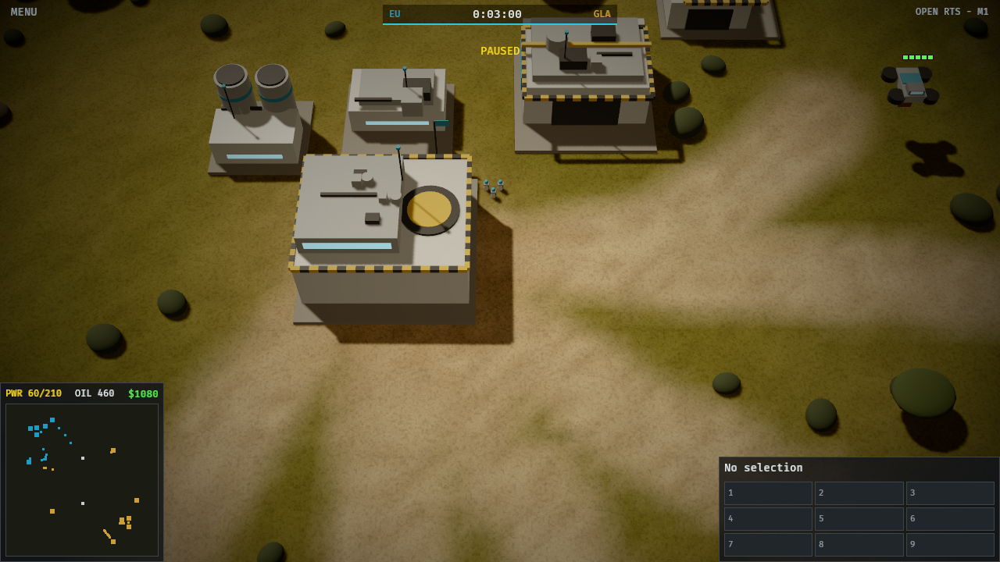
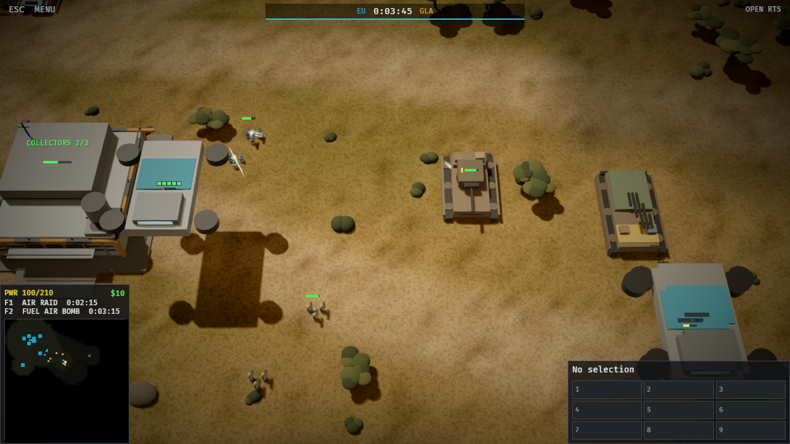
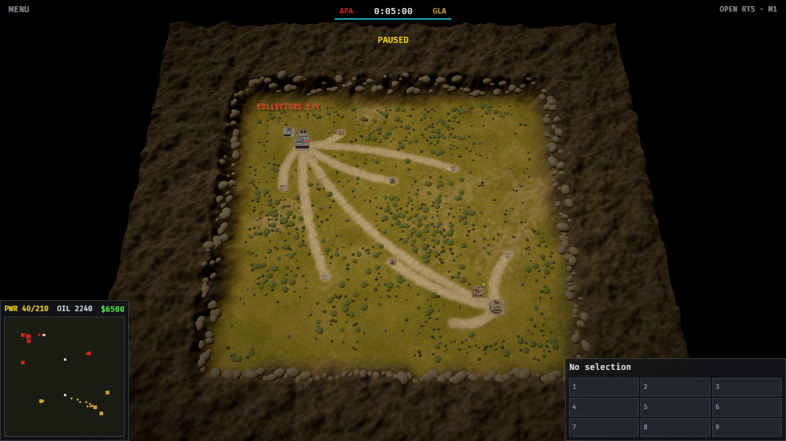
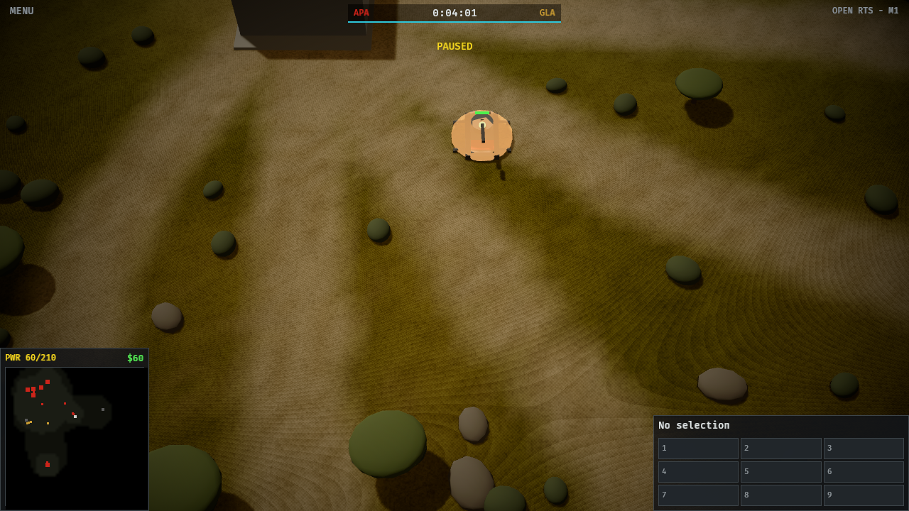
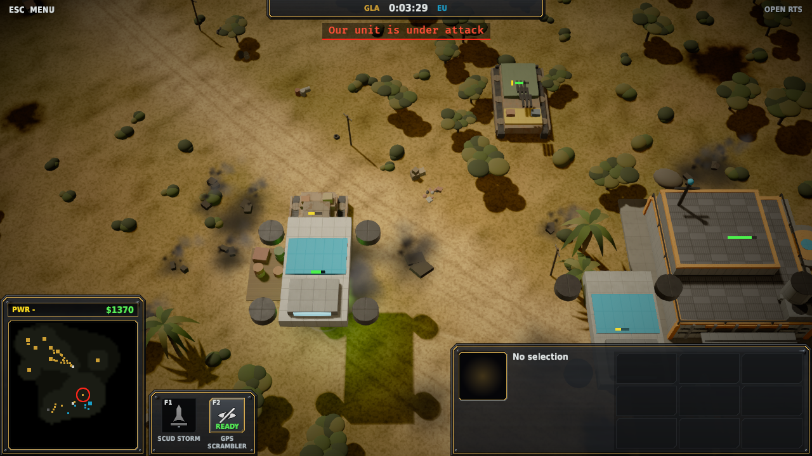
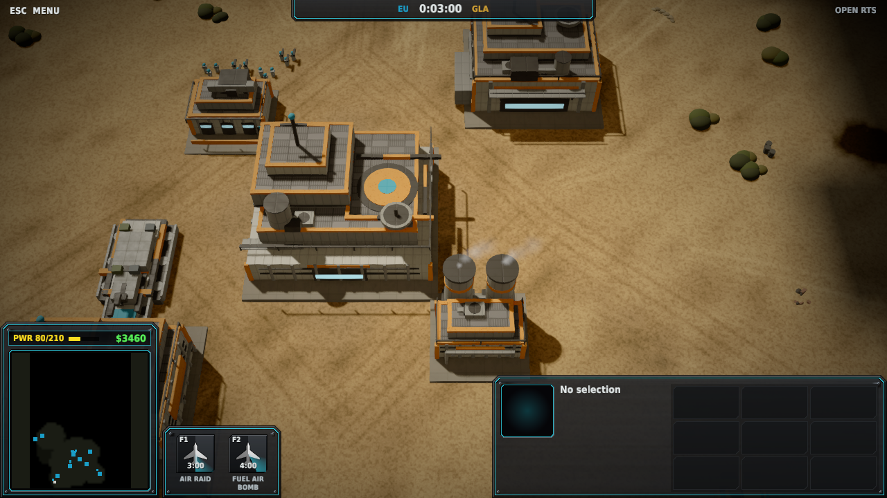
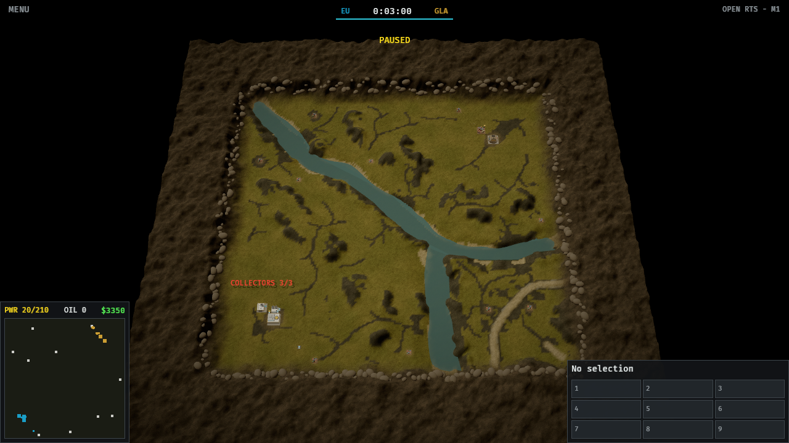

# generals2

Open-source recreation of the cancelled *Command & Conquer: Generals 2*, as a new engine written in Rust. Not affiliated with or endorsed by EA. All trademarks are the property of their respective owners.

The engine needs no game files. EA's GPL release of *Generals/Zero Hour* in `vendor/` is reference for the engine: no code from it is ported or copied into `crates/`. The one runtime use of `vendor/` is map data: the original Generals and Zero Hour **maps** can be played, read at runtime from EA's GPL map sources (`vendor/ea/CnC_Modding_Support`, a git submodule) and never copied into this repository. All art is original and procedural: meshes built from primitives, generated terrain and textures, our own HUD design. The archived 2013 footage sets the target mood (warm hard light, steep camera, savanna ground); `docs/STYLE.md` describes it as requirements, not as elements to copy.

## Status: milestone 4, artillery

What works:

- **Deterministic simulation** (`crates/g2-sim`): 30 ticks/s like SAGE, 48.16 fixed point, PCG32, a generational entity arena, a per-tick state hash. No floats in state, no dependencies, no IO. About 68,000–70,000 ticks/s single-threaded (about 2,300× real time) for a 10-minute 2-player AI match on Crater Ridge, with armies, artillery and fog. Artillery made matches larger (71 entities at the end of the bench match, up from 40), and unit updates and fog now take about two thirds of a tick.
- **Generals 2 economy**, from the archived sources:
  - Credits from supply piles, carried by collectors to a supply center.
  - Collector cap per supply center: **EU 3, APA 5, GLA 8**.
  - Oil derricks, which can only sit on oil wells and pay credits until the well is dry. The archived sources say oil was first meant to be a second resource, but the August 2013 patch made derricks "provide additional funds"; this follows the patch, so credits are the only currency.
  - Local power: plants power consumers within a radius. Unpowered production runs at half speed. The GLA has no grid.
  - Constructors place foundations that must be worked on, production queues with full refunds on cancel, and surrender/defeat.
- **Three factions** (`crates/g2-rules`): EU, APA and GLA. Command center, constructor, supply center, collector, power plant, oil derrick, barracks and war factory each, plus one infantry squad, one tank and one artillery piece (EU Recon Squad, Aegis and Howitzer; APA Red Guard, Warlord and Thunderfist; GLA Rabble Squad, Scorpion and Toxin Artillery). Sourced numbers are tagged `// src:`, everything else is a placeholder.
- **Combat**: four armour classes from the archived unit cards (Infantry, Light, Heavy, Structure). A weapon deals its base damage plus a per-class bonus, the way the cards state it ("40, bonus 30 vs. Light"), every cooldown, to one target within range. Direct fire hits at once. A squad is one entity carrying the squad's card values. Sourced: the Red Guard's rifles (13, +2 vs. infantry, 0.9 s, range 25) and the Warlord's guns (40, +30 vs. Light, 1.5 s, range 35), plus hit points, costs and build times where the cards give them; everything else borrows those two weapons or is a placeholder. Orders: attack a unit or building; attack-move (fight anything met on the way); idle armed units guard their spot, engage what comes within range plus 15, chase it on a leash of the same distance, then walk back. All shots of a tick land together after every unit has moved, so the result never depends on entity order and two tanks can kill each other on the same tick. A player with no buildings and no constructors left is defeated.
- **Artillery**: shell weapons lob a shell at the spot the target stood on when it fired. The shell lands after its flight time (distance over shell speed) and damages every enemy whose edge is within its blast radius, with each victim's armour bonus; a unit that moved away in the meantime is missed. Splash never hurts the shooter's side. Artillery has a minimum range and won't fire inside it. Shells in flight are part of the state hash.
  - **APA Thunderfist** (sourced: hp 600, Heavy, $980, 21.51 s; cannon 40 +30 vs. light, 1.65 s, range 30; deployed howitzer 100 +30 vs. light, 4 s, range 65): it drives and fights with its cannon and must deploy (stop and set up, 3 s, a placeholder) to fire the howitzer. It deploys on its own when an attack target, or an enemy met on an attack-move or while guarding, is beyond the cannon but within the howitzer's reach. Deployed it can't move: a move order packs it up first, and on an attack-move it packs up once nothing is left in the howitzer's reach. The card's +100 against garrisoned buildings goes to every building, since there are no garrisons. It sees as far as the howitzer reaches.
  - **GLA Toxin Artillery** (sourced: hp 950, $1000, 30.11 s) and **EU Howitzer** (placeholder throughout; no EU artillery card is archived): both fire on the move. The toxin shell's damage over time is not modelled.
  - Blast radius, shell speed and minimum range are placeholders, shaped like Zero Hour's artillery.
- **Generals as data**: a player may pick a general of their faction; its modifiers change the cost and build time of specific units and buildings (integer percent, deterministic, refunded at the price paid). One per faction so far: **Bulldog** (EU), **Taskmaster** (APA), **Junkyard** (GLA). The names are documented Generals 2 generals; their effects are placeholders, mod-style sub-generals (per-unit cost and time changes). The general is part of the state hash and of replays (format v3; v1/v2 still load), and replay files naming an unknown or wrong-faction general are refused with an error.
- **Fog of war** (`crates/g2-sim/src/fog.rs`): each player has an 8-unit grid of *visible* cells, recomputed every tick from the sight of their units and finished buildings, and *explored* cells, the union of everything ever visible. Enemy buildings are remembered as last seen; a remembered one seen destroyed is forgotten. No Generals 2 source gives sight ranges, so they follow Zero Hour's data (EA's GPL release), where an armed unit sees as far as its weapon reaches: here range + 15 (the guard's acquisition margin), so a guard sees what it would engage; unarmed units see 25, buildings 30, plus their radius. Vision and memory are part of the state hash. Fog applies to every player and to the AI alike:
  - Guards and attack-moves only engage visible enemies, and drop a target that walks into the fog.
  - An attack order needs a target the player sees, or an enemy building it remembers. Once given, the order follows its target through the fog while it lives.
  - The AI defends against visible intruders only and sends its waves to the nearest building it remembers. With none remembered it scouts the nearest start, oil well or supply pile it hasn't explored, then any unexplored cell, so every match still ends.
- **Built-in AI** that plays the whole game: it builds its economy and a barracks and war factory, keeps both training (the war factory alternates its tank and its artillery, about two tanks per gun), defends its base with the units at home, and attacks in waves of five. A lost constructor is retrained before anything else is spent on the army. It runs inside the sim and issues ordinary commands, so AI matches replay exactly; every faction pairing ends with a winner in a test.
- **Pathfinding** (`crates/g2-sim/src/nav.rs`): units route around buildings, foundations, resources and, on imported maps, cliffs and water. A 2-unit grid; a cell is blocked when it lies within a static's radius plus a unit's radius, or overlaps terrain the original engine marks impassable (the map's own cliff bits, or for pre-v7 maps the engine's 9.8-unit height-span rule, and cells under a water area). Integer A* with fixed tie-breaking and line-of-sight smoothing; an unreachable goal routes to the closest reachable cell. A unit walks straight while the line is clear and plans only when it isn't. Routes are entity state and part of the hash. Buildings can't be placed on cliffs or water. Collectors don't push each other (two meeting head-on in a gap between buildings blocked each other for good), and a test checks, on the tightly packed base layout that exposed both bugs, that no EU or APA collector stands still for 20 s on a gather run; it fails if routing or the collector exemption is switched off.
- **Replays**: setup + human commands + a state hash every second, plus a fingerprint of the map, so a replay whose map file has since changed is reported as such instead of as a divergence. `g2-tools verify` re-simulates a replay and names the first tick that diverges. A committed golden replay fails the test suite on any unintended behaviour change.
- **Bevy 0.20 client** (`crates/g2-client`):
  - RTS camera, selection, and context orders (attack, move, gather, help build; Ctrl + right click attack-moves).
  - Build placement with validity preview (derricks snap to wells).
  - Production hotkeys, a HUD, pause and ×1–×8 speed. The build grid shows prices after your general's modifiers, and the match bar names both generals.
  - Collectors: cargo pips over your own collectors, a "+credits" pop-up over the supply center on every delivery (none are lost at ×8; a test compares them with the sim), and Tab cycles through your collectors.
  - Interpolated movement between sim ticks.
  - `--record FILE` saves the match as a replay on exit, for `g2-tools verify`.
  - A headless `--screenshot` mode that renders one frame and checks that every sim entity has exactly one model at its sim position. `--view base|map|battle` picks the in-game camera over your base, a whole-map overview, or the in-game camera over the latest shots; the frame includes the last few ticks' tracers, kill flashes and blasts, and every shell still in the air at the point of its arc it has reached.
  - Combat: barracks, war factories, infantry squads, tanks and self-propelled guns in each faction's style (team-coloured helmets and roof bands), a glowing tracer per direct hit and a fireball per kill. Shells fly on an arc for their flight time and land in a blast the size of their radius; the Thunderfist's stabiliser legs slide out while it sets up. `T` deploys the selected Thunderfists, or packs them up if all are set up; the selection panel shows the mode.
  - Fog: a dark sheet over the ground, soft-edged between cells (black where unexplored, dimmed where explored but out of sight); scenery on unexplored ground is hidden. Enemy units show only where visible, remembered enemy buildings stand where they were seen, and the minimap has the same fog layer. A remembered building destroyed out of sight stays drawn (model and minimap dot) as a ghost until you see its spot again, so a kill you didn't watch isn't given away. Hits and kill flashes show only where one end is visible, and hidden enemies can't be clicked. A building hides the scenery it covers only once you can see it, so a clearing doesn't give away a base in the fog. `--reveal` turns your fog off for watching (the sim's fog still applies).
- **Visuals** (`look.rs`, `terrain.rs`, `models.rs`, `hud.rs`): narrow-FOV steep camera, a low warm sun with cascaded shadows, AgX tonemapping with a warm grade, distance haze and a vignette. The terrain is procedural savanna with dirt roads, a tiling detail texture, trees, bushes and rocky rims. As in the 2013 footage, scenery grows right up to the bases: only the command center and resource spots start clear, and a building hides any scenery it covers while it stands. Each faction has its own procedural models: EU grey panels with hazard trim and a ducted-fan collector, APA dark steel with red accents, GLA scrap walls and crate yards. Construction sites have grey scaffolding, team-coloured netting and a tower crane. The HUD shows live data only: match bar, resources, a minimap with team dots and neutral resources, a selection panel with a training queue and a 3×3 production grid, plus collector counts and health bars in the world.
- **Original Generals / Zero Hour maps** (`crates/g2-maps`): a reader for the SAGE `.map` format (RefPack and zlib compression, the `CkMp` chunk container). It turns a map into a match: player starts, supply docks and piles with their retail amounts (boxes × 75 credits), and tech oil derricks as oil wells. All 174 official maps in `vendor/ea/CnC_Modding_Support` parse; 85 of them have two or more player starts and can host a skirmish. In the client the original relief, painted ground (grass, sand, rock, snow, paved), road network, water areas and tree, bush and rock positions are drawn in our own procedural style; models, the cursor and the camera follow the rendered ground. `g2-tools maps` lists them; `--map zh:Tournament Desert` picks one. Map names in replays are checked so they cannot name paths outside the map folder. Scale: 6 SAGE units = 1 world unit, so a retail command center matches ours.

Not yet:

- Splash damage beyond artillery, veterancy, upgrades, aircraft, garrisons, stealth and detection, and shroud-clearing abilities. There is no velocity-based local avoidance: units overlap and get pushed apart afterwards (except collectors, which pass through each other). Measured on open ground and around a building with groups of 5–16, that leaves no overlaps at rest, no unit stuck while moving and paths within 1–8% of straight, so it is not built yet. A group moves at its slowest member's pace and keeps the shape it gathered in; formation slots face the direction of travel and are dealt out so no two units' paths cross.
- The AI doesn't use artillery on purpose: guns go out in the same waves as tanks and deploy only when an enemy comes into reach, rather than setting up behind the line.
- Generals' unique units, player powers and the per-general perk progression (rank, perk slots; archived patch preview #2). Only cost/time modifiers exist.
- The Onslaught PvE mode, networking, real art, audio.
- **Balance is unexamined and lopsided.** In 72 AI-vs-AI matches on Crater Ridge with fog and artillery (all 9 pairings, seeds 1–8; the AI uses no randomness, so the seed changes nothing) the first start won 32 and the second 40; the EU won 40, the APA 16, the GLA 16. Every match ended, after 6 to 12 minutes. The split has flipped with every AI change (40/32 with fog alone, 32/40 before fog). The two AIs build mirror-image bases (a test checks it) and their units leave the side of each building facing the map centre, yet mirror matches still drift apart after about two minutes. The cause is in per-tick processing, not the layout: the AI of the first start thinks one tick earlier, and movement, separation and pathfinding work on a fixed grid and in entity order, which a 180° rotation does not preserve. Nothing here says anything about faction strength. The unit numbers come from three sourced weapons stretched over nine units.
- The AI rebuilds a lost constructor but does not protect it, and keeps no reserve, so an AI under pressure can lose several in a row.
- The **"base proxy" rule**: Wikipedia says a faction "must have 'captured' a resource stash before letting its harvesters in". The archived sources don't say how capture works, so for now any player can gather from any pile.
- Rules are const Rust tables, not data files.
- On imported maps **bridges are not walkable yet**: their width comes from the bridge models, which we don't have. On 5 of the 85 skirmish maps (Final Crusade, Heartland Shield in both games, Winding River, FloodedPlains) some starts are cut off from each other by water; every start still reaches its own supply. Slopes are walkable and buildings may stand on them; heights don't affect the sim. Retail tech buildings, civilian structures, cliff textures, blended ground edges and scripts are ignored. Oil wells are finite (10,000 oil each), unlike retail derricks. Water surfaces are flat, opaque fans over each area's outline (opaque so the fog sheet can draw over them), so a strongly concave lake can overhang its shore. Under fog, a thin bright fringe can remain where a shore meets unexplored ground: the fog sheet lies on the water surface only where its vertices fall inside the water outline. Only 2-player matches are supported, even on 4-, 6- and 8-start maps.







*Above, each under player 0's fog of war: an EU base at 3:00 (EU vs GLA AI, `--view base`); a GLA raid of Scorpion tanks and Rabble squads on an EU oil derrick foundation at 3:20 (`--view battle --ticks 6019`); and APA (red) vs GLA (sand) after 5 minutes of AI vs AI (`--view map`), where only the APA's explored ground is lit and the GLA base stays hidden. All rendered headless with `--screenshot` on the integrated Radeon (RADV GFX1150).*





*Above: artillery. A deployed APA Thunderfist with its legs out (APA vs GLA, `--spectate --view battle --ticks 7233`), and a GLA Toxin Artillery shell landing among EU Recon squads, its blast drawn at its radius (GLA vs EU, `--spectate --view battle --ticks 6160`).*





*Above: original maps, read from EA's map sources and drawn in this project's style, under the EU's fog at 3:00: `--map "zh:Tournament Desert"` (base view) and `--map "zh:Winding River"` (`--view map`), where the river stays dark outside explored ground.*

**Verification status.**

- The README frames were rendered on this host, and the mirror check passed for each (51/51, 52/52 and 45/45 entities for the first three, 41/41 and 51/51 for the artillery frames, none misplaced; hidden enemies keep their model, hidden). The HUD totals match `g2-tools record --seed 1` for the same matches: EU at 5,400 ticks shows `$2195`, power 60/210; APA at 9,000 ticks shows `$105`, power 60/210. The same APA frame with `--reveal` shows the GLA base and its minimap dots; with fog it doesn't.
- Fog tests: an attack on an enemy never seen is rejected; once scouted, the building can be attacked from out of sight and the order holds through the fog until the tank fires (the test fails if memory isn't accepted, or if the order is dropped in the fog); scenery on unexplored ground stays hidden until a unit explores it; an enemy foundation raised on explored ground out of sight doesn't clear the scenery on it; an enemy command center destroyed out of sight keeps its model and the scenery clearing under it until our dozer sees the spot again (fails if ghosts are dropped). The headless mirror check allows a model with no sim entity only if the fog still remembers it.
- Artillery tests (`crates/g2-rules/tests/artillery.rs`): a shell lands on the spot after distance over speed and misses a target that drove off (fails with instant shells); every enemy in the blast is hit and our own worker standing in it is not (fails if splash hits friends); no shot inside the minimum range; the Thunderfist deploys and packs up in its set-up time, can't move while deployed, and rejects `Deploy` for units that can't; it deploys on its own for a target beyond its cannon on an attack order and on an attack-move; AI matches with artillery replay to the same hash. The reference replay was re-recorded on purpose for artillery.
- A test drives the real Bevy schedule without a renderer: orders between frames, a ×4 burst, then a saved replay. That replay verifies to the same final hash, which covers the client's command path end to end.
- Imported maps: all 174 official maps parse in a test; a recorded AI match on `zh:Tournament Desert` round-trips through a replay and verifies to the same hash, and a moved resource is caught as a changed map; terrain tests check that starts sit on the battlefield level, original scenery stays off bases and water, the ridge past the edge has no steps, and water surfaces stay inside the map; a test aims camera rays at 361 points on Defcon6's terraces and checks each lands within 0.5 units. Tournament Desert, Alpine Assault, Golden Oasis, Defcon6 and Winding River were rendered headless with the mirror check passing (models on terrain, none misplaced): Tournament Desert 70/70, Winding River 72/72 for the frames above. On Winding River the unexplored river measured about 24–27 luminance under fog against 78–86 with `--reveal`. In an A/B of the water drawing (fog milestone), translucent water was dark at some unexplored river points and nearly revealed-bright at others (blending order depends on each mesh's distance to the camera); opaque water without lifting the fog sheet onto its surface stayed at the revealed brightness everywhere; opaque water with the lift is dark throughout.
- The **interactive** window (mouse, keyboard, camera) has not been exercised; the build host has no display. That includes the attack and Ctrl attack-move orders, mixed selections (armed units attack, the rest walk to the spot), clicking onto hills (the ray march itself is unit-tested), clicking remembered buildings in the fog, `T` to deploy, and the camera easing up and down terrain while panning. The "+credits" pop-ups, moving tracers, shells flying along their arc, blasts growing, the Thunderfist's legs sliding out and the fog sheet updating as units move have only been seen frozen in screenshots; a test checks that every delivery reaches the pop-up queue at ×8, and one that a shell handed over partway through its flight starts at that point of its arc and lands on time.
- **GPU on the build host:** the discrete amdgpu device (`c7:00.0`, MI50) is wedged; opening it hangs the process in D state. Run every GPU command through `scripts/igpu-only/run.sh`. It hides the MI50's DRM nodes with an `LD_PRELOAD` shim, so only the integrated Radeon (`c8:00.0`, `renderD128`) is enumerated. strace confirms `renderD128` is the only device node opened:

  ```
  scripts/igpu-only/run.sh target/release/g2-client --screenshot shot.png --ticks 5400 --view base
  ```

- To render on the CPU instead (Mesa lavapipe):

  ```
  VK_DRIVER_FILES=/usr/share/vulkan/icd.d/lvp_icd.json WGPU_BACKEND=vulkan cargo run -p g2-client --release -- --screenshot shot.png
  ```

## Layout

```
crates/g2-sim      deterministic simulation (no deps): fixed point, RNG, entities, economy, AI, replays
crates/g2-rules    faction/unit/building tables, the built-in map; economy + determinism tests
crates/g2-client   Bevy 0.20 app: look (camera/light/grade), terrain, models, view, input, HUD, headless screenshot
crates/g2-maps     reader for Generals / Zero Hour .map files: chunks, heights, textures, objects, water
crates/g2-tools    CLI: verify / record / bench / summary / maps
scripts/igpu-only/ LD_PRELOAD shim + wrapper that restricts Vulkan to the integrated GPU on the build host
archive/           research material, local-only and untracked (fetch scripts in scripts/), see the local field notes
vendor/            upstream source as git submodules (reference only), see vendor/README.md
the local field notes   annotated index of everything archived
docs/STYLE.md      visual target: mood and readability requirements
```

## Build and run

Rust 1.99+.

```
cargo test --workspace                               # unit, economy, determinism, golden replay
cargo run -p g2-client --release                     # play EU vs GLA AI
cargo run -p g2-client --release -- --faction gla --enemy apa --seed 4
cargo run -p g2-client --release -- --spectate       # AI vs AI
cargo run -p g2-client --release -- --spectate --reveal   # AI vs AI without fog
cargo run -p g2-tools --release -- maps             # list the original maps that can host a skirmish
cargo run -p g2-client --release -- --map "zh:Tournament Desert" --faction apa
cargo run -p g2-client --release -- --record my.g2rp # then: cargo run -p g2-tools --release -- verify my.g2rp
cargo run -p g2-client --release -- --screenshot shot.png --ticks 1800   # on this host, wrap with scripts/igpu-only/run.sh
cargo run -p g2-tools --release -- bench
cargo run -p g2-tools --release -- record match.g2rp --factions apa,gla --ticks 18000 --map "gen:Alpine Assault"
cargo run -p g2-tools --release -- verify match.g2rp
```

Bevy is built with an explicit **X11-only** feature list (see the root `Cargo.toml`), because the build host lacks Wayland development headers. On a host that has them, add `"wayland"` to the list.

### AppImage

`scripts/build-appimage.sh` builds `dist/Generals2-x86_64.AppImage` (about 66 MB): the client compiled in a Debian 12 container, the 174 official Generals and Zero Hour maps (only their `.map` files, 45 MB unpacked) and EA's licence for them (GPL-3.0 with section 7 terms). It needs docker and network on the build machine. `--no-maps` leaves the maps out.

On the target machine:

```
chmod +x Generals2-x86_64.AppImage
./Generals2-x86_64.AppImage                          # same arguments as g2-client
./Generals2-x86_64.AppImage --map "zh:Tournament Desert"
```

Requirements: x86-64 Linux with glibc 2.35 or newer (Ubuntu 22.04+, Debian 12+, Fedora 36+), an X11 session or XWayland, and a GPU with a Vulkan driver (Mesa or the vendor's). Nothing else is bundled: X11, Vulkan and the driver come from the host. Without FUSE, run it with `--appimage-extract-and-run`. Imported maps are found in the AppImage; `G2_MAPS_DIR` still overrides them.

Verified on the build host: the AppImage renders headless (`--screenshot`) on the built-in map and on `zh:Tournament Desert` and `gen:Alpine Assault`, with the source tree's own Zero Hour maps moved out of the way so only the bundled copy could be read. It has not been run on another machine or in a window.

## Controls

| Input | Action |
|---|---|
| Left click / drag | Select own units (click selects buildings too); Shift adds |
| Right click | Enemy → attack (unarmed units in the selection walk there); supply pile → gather; own foundation → help build; ground → move |
| Ctrl + right click | Attack-move: armed units fight anything they meet on the way |
| Constructor selected: `1`–`9` | Choose a building; left click places (Shift repeats); Esc / right click cancels |
| Building selected: `1`–`9` | Queue production; Backspace cancels the last item |
| WASD / arrows / screen edge | Pan; mouse wheel zooms; Q/E rotate |
| Space | Pause; `+`/`-` change speed (×1–×8) |
| Tab | Select the next own collector and centre the camera on it |
| T | Deploy the selected Thunderfists (howitzer), or pack them up if all are deployed |
| F10 | Surrender |

## Determinism rules for `g2-sim`

Every change to the simulation must keep replays bit-exact:

- No `f32`/`f64` in state or logic; use `Fx`. `Fx::to_f32` exists only for rendering.
- No `HashMap`/`HashSet` iteration, system time, threads or IO.
- Iterate entities in index order. Every new state field goes into `World::state_hash`.
- Intentional behaviour changes regenerate the golden replay: `G2_BLESS=1 cargo test -p g2-rules --test determinism golden`.

## Inspiration

[Strong Hold](https://yannickaaron.github.io/Strong-Hold/), a native Rust engine for *Stronghold Crusader*. We took the following ideas from it:

- A simulation crate with no dependencies, kept apart from the app.
- Checking every tick against recordings.
- Fast-forward.
- Bringing the engine, not the game.

The difference: Strong Hold reimplements an existing game and checks it against the original binary. Generals 2 never shipped, so we check against our own recorded replays.

## Legal

`vendor/` contains GPL-3.0 code; the EA release carries GPL §7 additional terms (no trademark use, no claims of EA affiliation, modifications must be marked). No code from it is in `crates/`; `crates/g2-maps` is our own reader written from the file format. Imported map data is read from `vendor/ea/CnC_Modding_Support` (or `$G2_MAPS_DIR`, for a binary run outside this tree) at runtime and never copied into the repository. Everything under `archive/` (videos, leaks, Wayback captures, wiki text, press pages, concept art, and their manifests) is third-party material kept local-only: it is gitignored, has never been in this repository's history, and is never redistributed. `the local field notes` links into it; those links resolve only in a local checkout that has run the fetch scripts.
