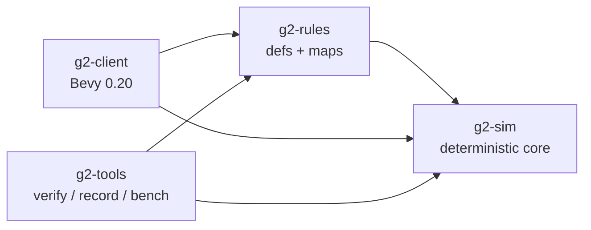

# Architecture

## Crates

- **g2-sim** owns all game state and has no dependencies. It is a plain struct world, not an ECS: entities live in a generational arena and are iterated in index order, which makes iteration order part of the spec instead of an accident.
- **g2-rules** is data: `static DEFS` and the built-in map. `g2-rules/tests` holds the behaviour tests, because they need real definitions.
- **g2-client** mirrors sim entities into Bevy entities for rendering and turns input into `CommandKind`s. Bevy's ECS never holds authoritative state.
- **g2-tools** runs replays and benchmarks headless.

## Tick

`World::step` runs once per 1/30 s (Bevy `FixedUpdate`, ×speed):

1. AI decides (once per second per AI player), producing ordinary commands.
2. Commands due this tick are applied in player order, then in submission order. Human ones are appended to the command log.
3. Production queues advance (half speed when unpowered).
4. Foundations with a constructor in contact advance.
5. Power is recomputed: each consumer takes capacity from the first in-range source of its owner, in index order.
6. Units move or run their order state machine (gather: to pile → load → to depot → unload).
7. Units are pushed apart pairwise and out of structures.
8. Oil derricks pay out once per second until their well is dry.
9. Depleted piles and defeated players' assets are removed; defeat is checked.

## Commands and replays

Input reaches the sim only as `Command { tick, player, kind }`. `World::submit` schedules a command `INPUT_DELAY` (2) ticks ahead, which leaves room for lockstep networking later. Invalid commands produce a `Reject` event and change nothing.

A replay is `{ map name, seed, players, length, human commands, (tick, state_hash) every 30 ticks }` in a small versioned little-endian format (`replay.rs`). AI commands are not stored: the AI is part of the sim and re-runs identically. `verify_replay` re-simulates a replay and returns the first checkpoint whose hash differs.

## Client frame

- `FixedUpdate`: `step_sim` stores each entity's position before stepping, for interpolation.
- `Update`:
  - `sync_entities` spawns or despawns placeholder meshes to match the sim.
  - `interpolate` blends unit positions by `Time<Fixed>::overstep_fraction`.
  - The camera, input (selection, context orders, placement preview) and HUD systems run.
- Headless `--screenshot`: steps the sim N ticks, renders one frame into an image target without winit, saves a PNG.

## Relation to SAGE and Strong Hold

From SAGE (Generals/ZH): only the 30 Hz logic rate and the general RTS shape. No code. From Strong Hold:

- The simulation as its own dependency-free crate.
- Tick-level verification against recordings.
- Fast-forward.
- No game files shipped.
